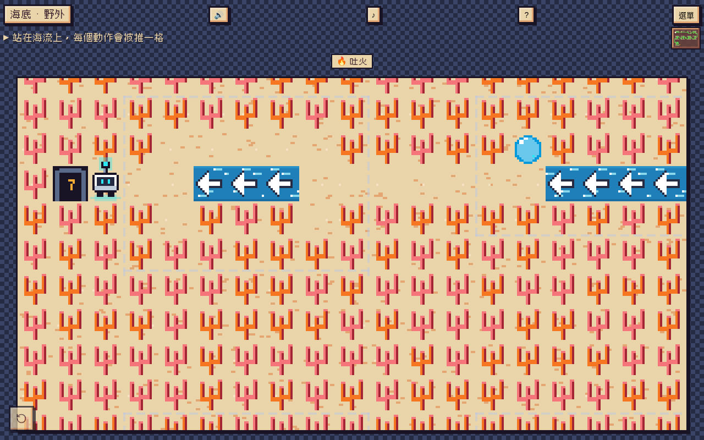
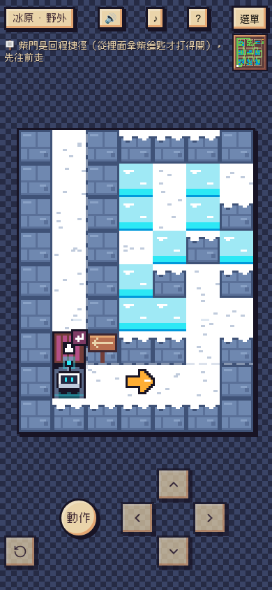
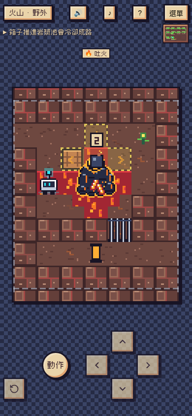
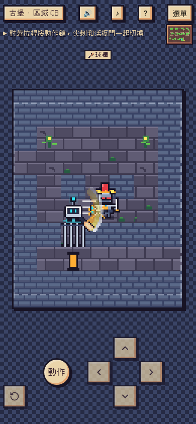
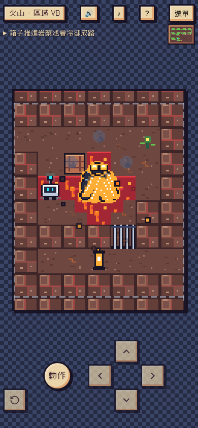
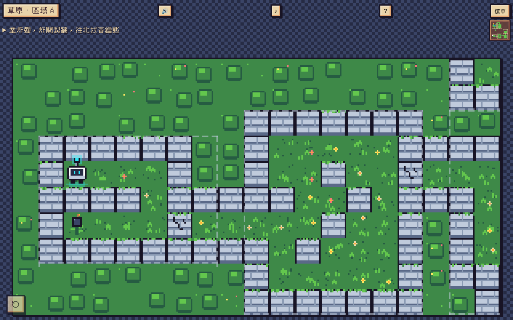
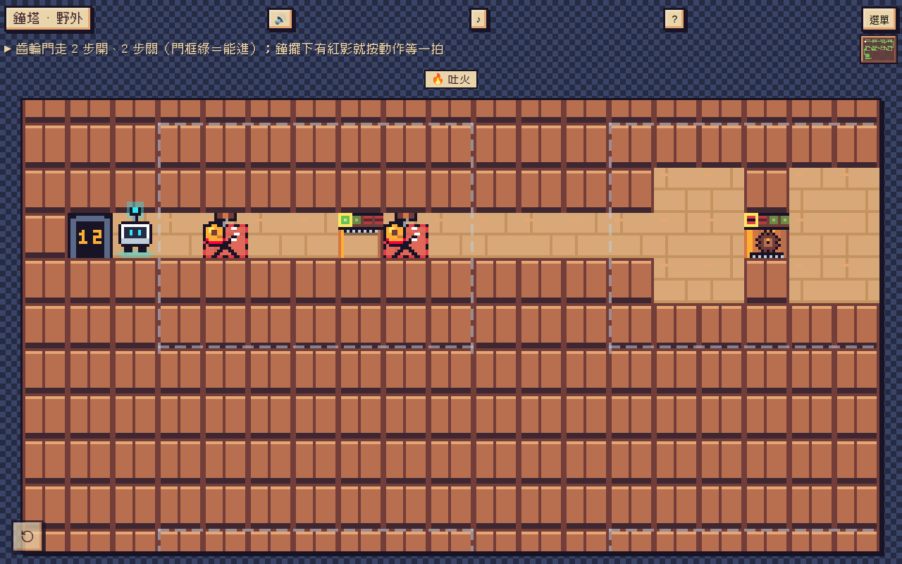

# glowbot

**Glowbot 小光｜像素解謎冒險**

▶ 線上遊玩：<https://jasper31943.github.io/glowbot/>（電腦和手機都能玩，打開網頁就能玩）

操作小機器人「小光」，穿過 15 個場景連成的大地圖，一區一區解開推箱子、炸彈、冰、岩漿、鏡子、電線、齒輪門等謎題，打倒各場景的迷你王，點亮燈塔燈，最後看到結局。進度會自動存在瀏覽器裡。

| 冰原（手機） | 炸彈範圍預告 | 球棒打昏盔甲騎士王 | 炸彈炸到熔岩巨人 |
|---|---|---|---|
|  |  |  |  |

## 怎麼玩

| 按鍵 | 動作 |
|---|---|
| 方向鍵／WASD | 移動 |
| 空白鍵／Enter／X | 動作：撿炸彈、放炸彈、揮球棒、吐火、拉拉桿、轉鏡子、切換轉轍器、開關發電機 |
| R（或畫面上的 ↺） | 把目前這一區恢復原狀；卡住時按它一定救得回來 |

手機上有畫面上的方向鍵和動作鍵。站在可以互動的東西旁邊時，小光頭上會出現提示，動作鍵也會發亮。怪物和王只在你走一步或按動作時才動；**紅框＝再動一步那格就會被打**，藍框＝不會受傷的變化。

## 15 個場景和迷你王

| # | 場景 | 迷你王 | # | 場景 | 迷你王 |
|---|---|---|---|---|---|
| 1 | 草原 | — | 9 | 古堡 | 盔甲騎士王 |
| 2 | 冰原 | — | 10 | 天空島 | 風暴鳥 |
| 3 | 沙漠 | 沙蟲王 | 11 | 鏡子迷宮 | 鏡影王 |
| 4 | 森林 | 老樹精 | 12 | 發電廠 | 電火花王 |
| 5 | 沼澤 | 泥巴蛙王 | 13 | 鐘塔 | 鐘塔守衛 |
| 6 | 礦坑 | 鼴鼠王 | 14 | 夜工廠 | 故障機王 |
| 7 | 火山 | 熔岩巨人 | 15 | 核心 | 故障核心（最終王） |
| 8 | 海底 | 巨蟹王 | | | |

每隻王的打法都不一樣，出招前一定提早一步用紅框標出來。

## 能力（拿到後一直帶著）

- 💣 **炸彈**（草原）：撿起炸彈草、放在面前，3 秒後十字爆炸，炸開裂牆、打倒怪物、扣王的血。放下時地上會出現黃色的爆炸範圍。
- **冰爪**（冰原）：站在普通冰上不會滑。
- 🔥 **吐火**（森林）：火往前直飛，燒掉藤蔓、融化冰塊、嚇呆怪物；會衝過來的王也能被火嚇呆。
- ⚾ **球棒**（森林出口）：貼著目標揮棒。怪物嚇呆並**往後擊退 1 格**，普通裂牆一棒打碎；會衝過來的三隻王（盔甲騎士王、電火花王、故障機王）會被打昏，從左右打還會被擊退一格。

| 草原：新遊戲開始 | 鐘塔的齒輪門和鐘擺 |
|---|---|
|  |  |

## 開發資料

- [開發說明（DEVELOPMENT.md）](DEVELOPMENT.md)：遊戲架構、地圖格式、規則、建置、測試和上線流程
- [更新紀錄（CHANGELOG.md）](CHANGELOG.md)：每次修改的問題、修正和 commit 編號
- [設計圖存檔（design/）](design/README.md)：角色、迷你王、各場景的美術設計表、設計稿和遊戲截圖

這個 repo 本身就是 GitHub Pages 網站：根目錄是上線的檔案，另外有地圖文字檔 `world/*.txt`、建置和檢查程式 `tools/`、測試 `test-*.js`，以及還沒接進遊戲的美術原始檔 `design/art-src/`。怎麼建置和跑測試見 [DEVELOPMENT.md 第 5 節](DEVELOPMENT.md#5-建置與測試)。
