# Glowbot 小光 設計圖存檔

這個資料夾保存開發過程中的美術設計圖、上線截圖，以及產生設計圖的程式。
**遊戲本身不會讀這裡的檔案**，刪掉也不影響遊戲；這裡只是存檔和參考用。

> 開發說明見 [../DEVELOPMENT.md](../DEVELOPMENT.md)，每次修改的紀錄見 [../CHANGELOG.md](../CHANGELOG.md)。

這個 repo 本身就是 GitHub Pages 網站，所以這些圖也能用網址直接看到，例如
`https://jasper31943.github.io/glowbot/design/previews/bat/bat_art_preview.png`。

## 資料夾

| 資料夾 | 內容 |
|---|---|
| `previews/bat/` | 棒球棒能力的美術設計（已上線） |
| `previews/characters/` | 單一角色的對比圖、尺寸檢查 |
| `previews/bosses/` | 各場景迷你王的設計表、王戰新招式的預告記號；`history/` 是沼澤／礦坑／火山王的修改過程 |
| `previews/scenes/` | 各場景的地板、機關、怪物設計表 |
| `previews/ui/` | 引導箭頭、卡住提示、燈塔燈、結局動畫等畫面元素，以及還沒放進遊戲的畫面設計稿 |
| `launch/` | 正式上線時各場景的實際遊戲截圖 |
| `levels/` | 關卡修正說明圖：Jasper 卡關的區域「為什麼過不去、現在怎麼過」 |
| `art-src/`、`tools/` | 美術原始檔和產生設計圖的程式，放在開發資料夾，**目前不在這個 repo 裡** |

設計圖大多是把實際的美術程式（`art.js`、`*-art.js`）畫在 16×16 的格子上，再放大 1～4 倍輸出，所以圖上看到的就是遊戲裡實際的樣子。

---

## 棒球棒（已上線）

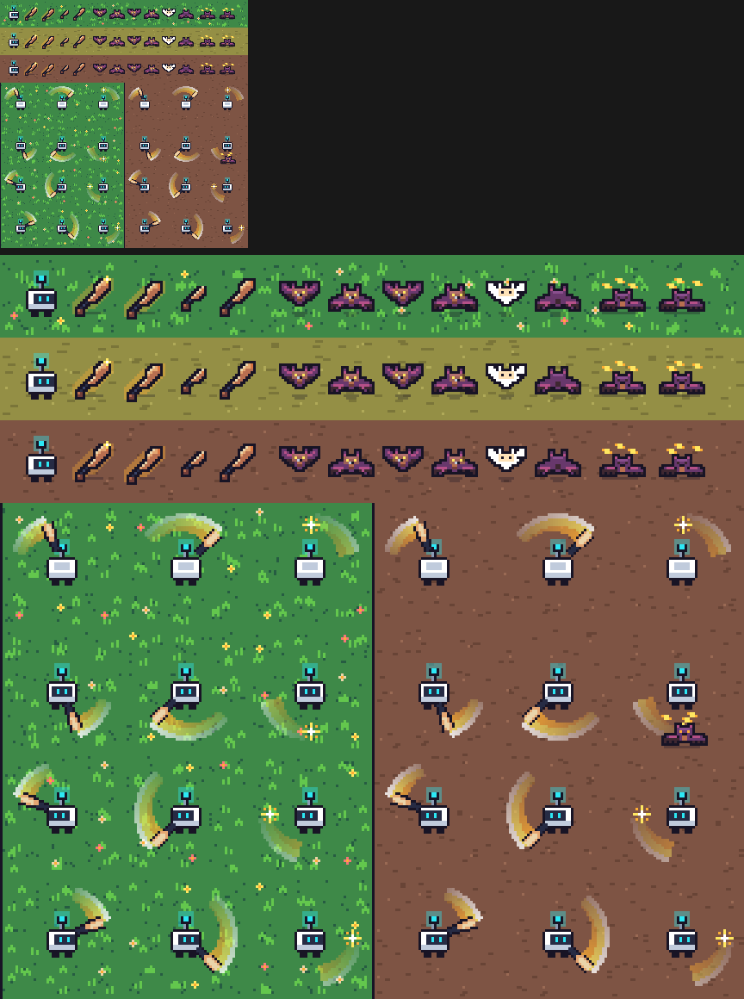

棒球棒能力的完整設計表。上半部是實際大小，下半部是同一張放大 3 倍。
- 前三排分別畫在草地、沼澤泥地、礦坑地面上，方便檢查在不同背景下清不清楚。每排從左到右依序是：小光、地圖上可以撿的球棒（亮光開／關）、HUD 小圖示（10px 和 16px）、礦坑蝙蝠（翅膀上／下、四個方向、受傷缺口、被打中閃白），以及被打暈攤在地上、頭上轉星星的蝙蝠。
- 下方的格子是揮棒動畫：每一列是一個方向（上、下、左、右），每一欄是一格動畫（舉棒、揮過、火花）。左邊畫在草地上，右邊畫在礦坑地面上。

| 圖 | 說明 |
|---|---|
| 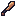 | `baseball_bat_icon_16.png`：HUD 用的 16px 球棒小圖示（透明背景） |
|  | `baseball_bat_icon_32.png`：同一個圖示的 2 倍版（32px），給高解析度螢幕用 |
| 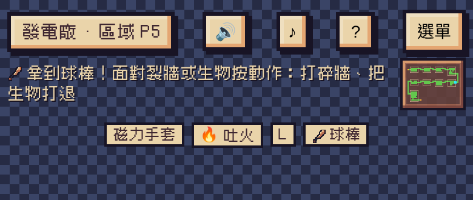 | `bat_icon_hud_phone.png`：上線後的手機畫面（發電廠 P5）：上方「球棒」標籤和「拿到球棒！」提示前面的像素球棒小圖。以前字型畫不出棒球圖案，會變成紫色圓圈或方塊（10-22 20:52 修正） |

遊戲裡實際用的是根目錄的 [`bat-art.js`](../bat-art.js)，函式有 `baseballBatItem`、`baseballBatIcon`、`batSwing`、`mineBat` 和 `mineBatStunned`。

## 角色

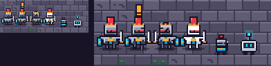

`knight_1x_2x.png`：古堡的盔甲騎士王（走路、受傷、轉向、暈眩）、小騎士和小光。左邊是實際 1 倍大小，右邊放大 2 倍，用來確認手機上看得清楚。

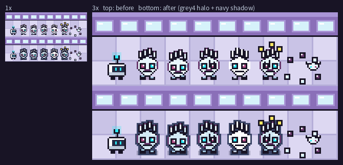

`mirror_king_contrast_preview.png`：鏡子迷宮的鏡影王改版前後的對比。上面是舊版，下面是加上深色外框和陰影的新版，各畫成 1 倍和 3 倍，背景都是實際的鏡子地板。

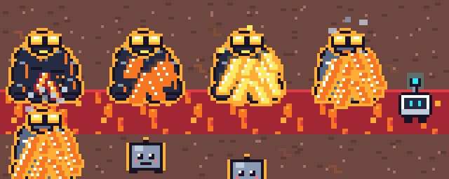

`lava_giant_rim_preview.png`：火山的熔岩巨人四個受傷階段、被打倒的動畫，以及小石頭夥伴，背景是火山地面和岩漿池。用來檢查巨人在岩漿上看不看得清楚。

## 迷你王

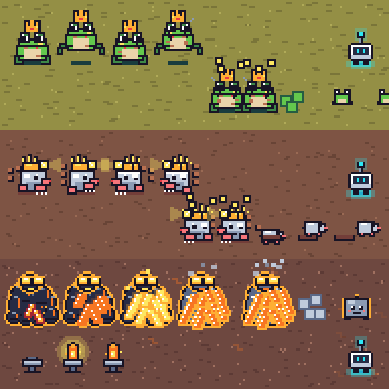

`bosses_567_preview.png`：第 5～7 場景的王。上面是沼澤的泥巴蛙王（跳躍、受傷、被打倒變小青蛙），中間是礦坑的鼴鼠王，下面是火山的熔岩巨人；每排右邊都放了小光對照大小。

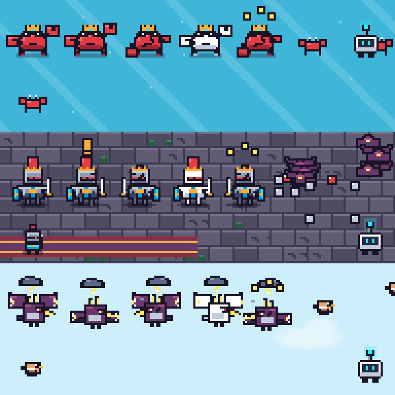

`bosses_8910_preview.png`：第 8～10 場景的王。海底的巨蟹王和小螃蟹、古堡的盔甲騎士王（背景是古堡地板和紅地毯），以及天空島的風暴鳥。

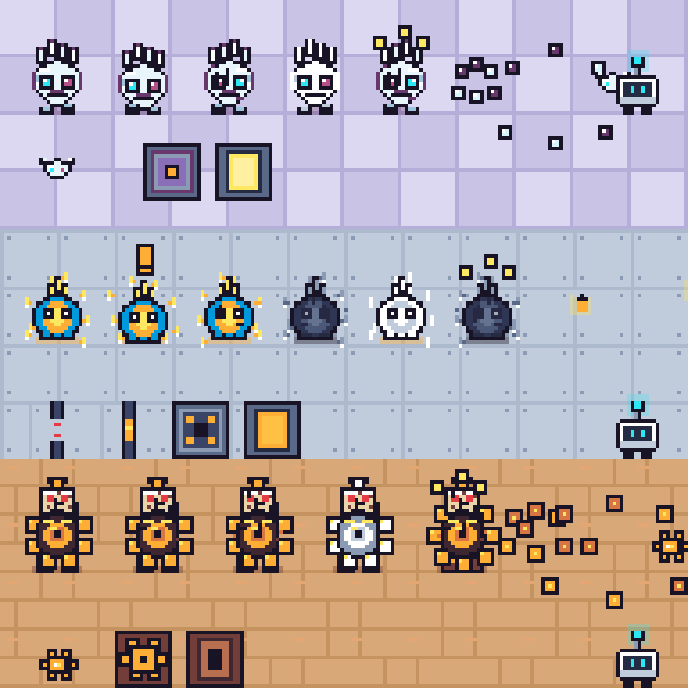

`bosses_111213_preview.png`：第 11～13 場景的王。鏡影王和玻璃夥伴、光門；電火花王、斷線和電門；鐘塔守衛和小齒輪。

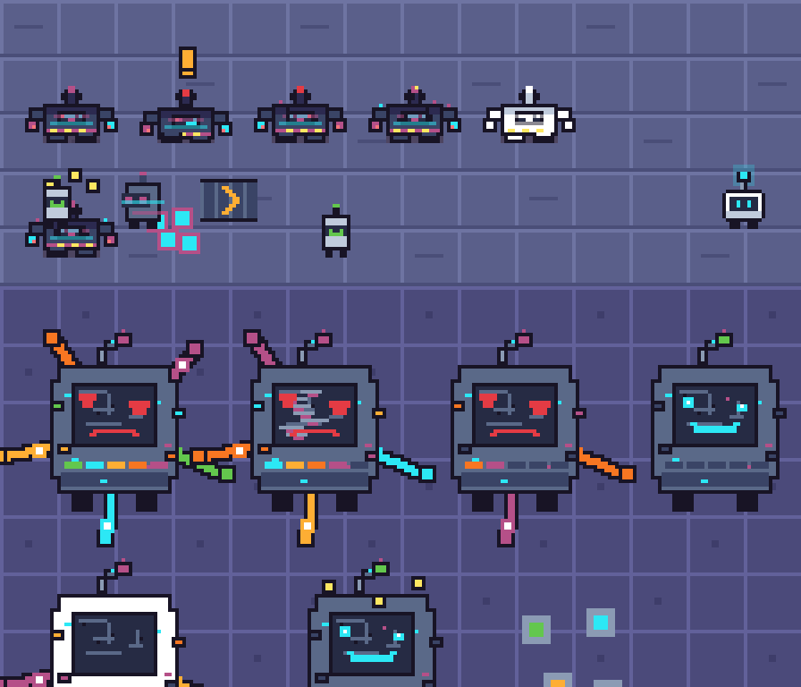

`bosses_1415_preview.png`：第 14～15 場景的王。夜工廠的故障機王、友善機器人、故障機器人和輸送帶；核心的最終王「故障核心」（48×48），包括各階段和被打倒的動畫。

### 王戰新招式的預告記號（王戰更新第 2 階段，10-22 上線）

每隻王都學會一招，而且一定提早一步預告：**紅框＝下一步會被打到，藍框＝不會受傷的變化**。每張卡片左邊兩格是記號動畫的兩個影格（放大約 5 倍），右邊是實際王房的截圖。被吐火或球棒打昏時，王頭上轉的星星沿用小怪的星星，沒有另外畫。

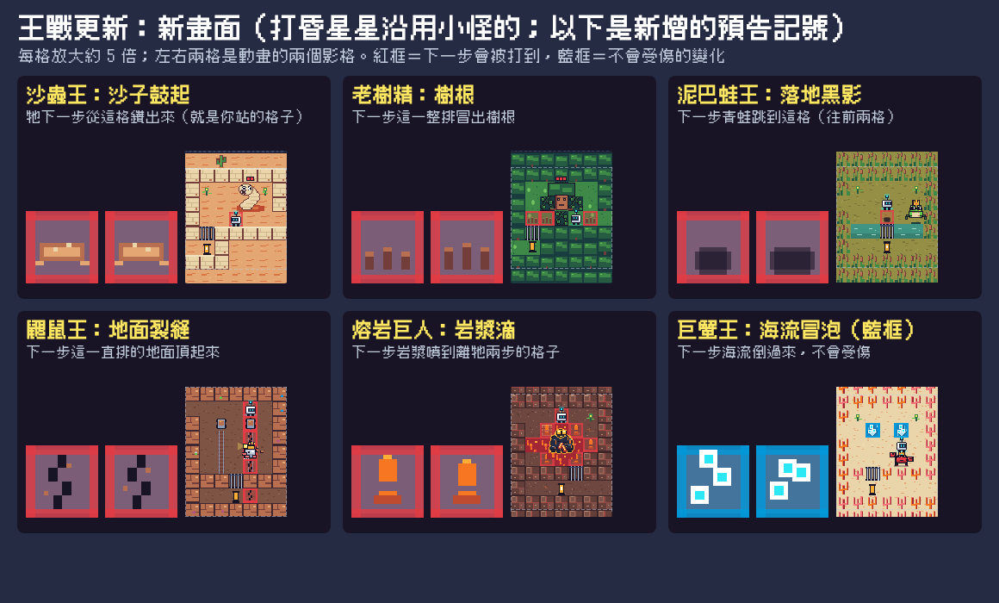

`boss_moves_03-08_preview.png`：第 3～8 場景（前半）。沙蟲王＝腳下沙子鼓起、老樹精＝整排冒出樹根、泥巴蛙王＝往前兩格的落地黑影、鼴鼠王＝整直排地面裂縫、熔岩巨人＝離牠兩步的岩漿滴、巨蟹王＝海流冒泡泡（藍框，下一步海流倒過來）。

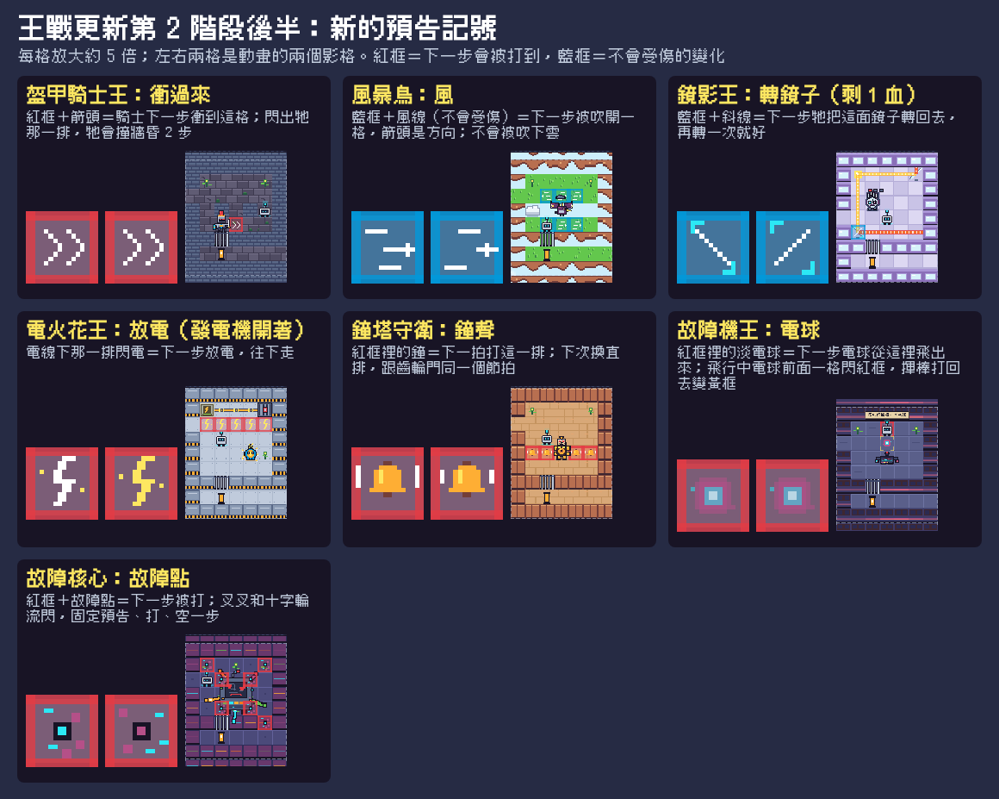

`boss_moves_09-15_preview.png`：第 9～15 場景（後半）。盔甲騎士王＝衝刺箭頭、風暴鳥＝風線（藍框，把你吹開一格）、鏡影王＝鏡子斜線（藍框，剩 1 血時把鏡子轉回去）、電火花王＝電線下閃電、鐘塔守衛＝紅框裡的鐘、故障機王＝電球（揮棒打回去變黃框）、故障核心＝故障點（叉叉和十字輪流閃，固定預告、打、空一步）。

### 修改過程（`previews/bosses/history/`）

沼澤／礦坑／火山王表的第 2～5 版，留著對照修改過程。最新的是上面的 `bosses_567_preview.png`。

| v2 | v3 | v4 | v5 |
|---|---|---|---|
| 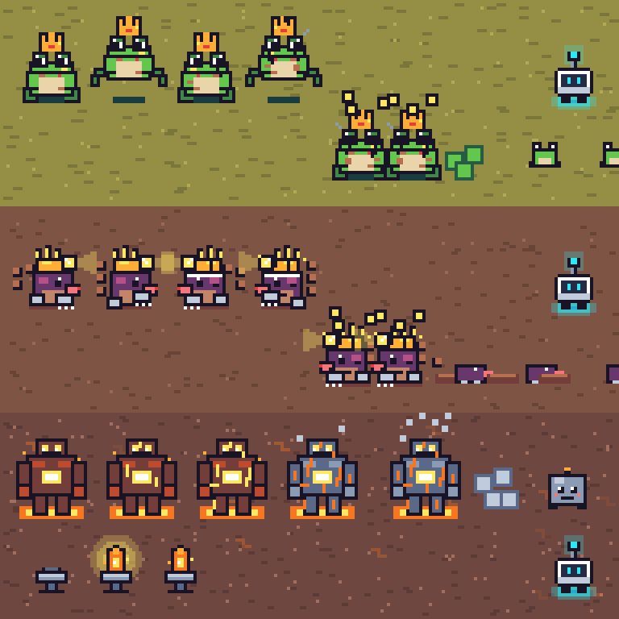 | 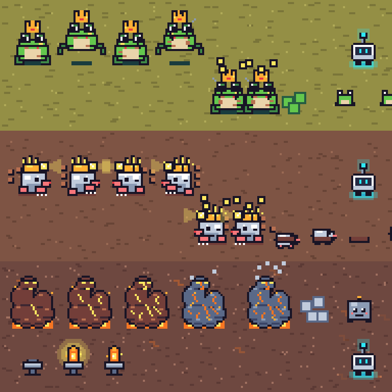 | 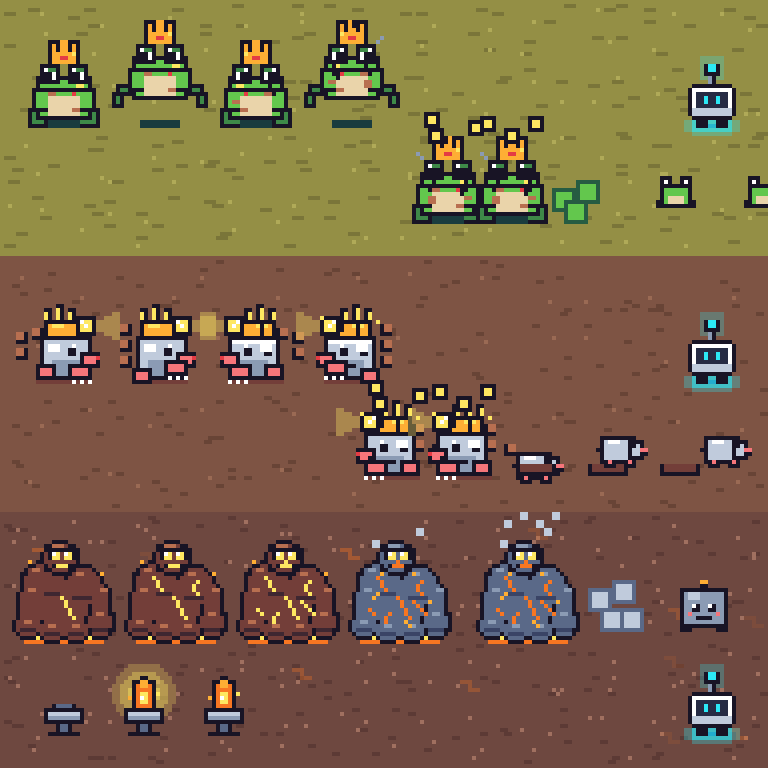 | 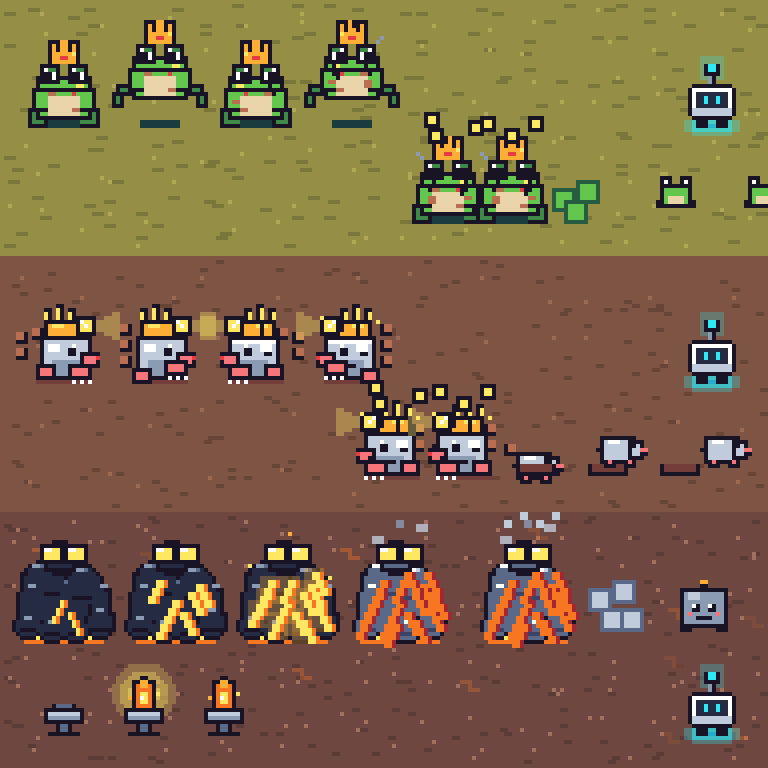 |

## 場景設計表

每張都是 12×7 格，畫出該場景的地板、牆、機關和怪物，並放一個小光對照。

| 場景 | 設計表 | 內容 |
|---|---|---|
| 冰原（2） | 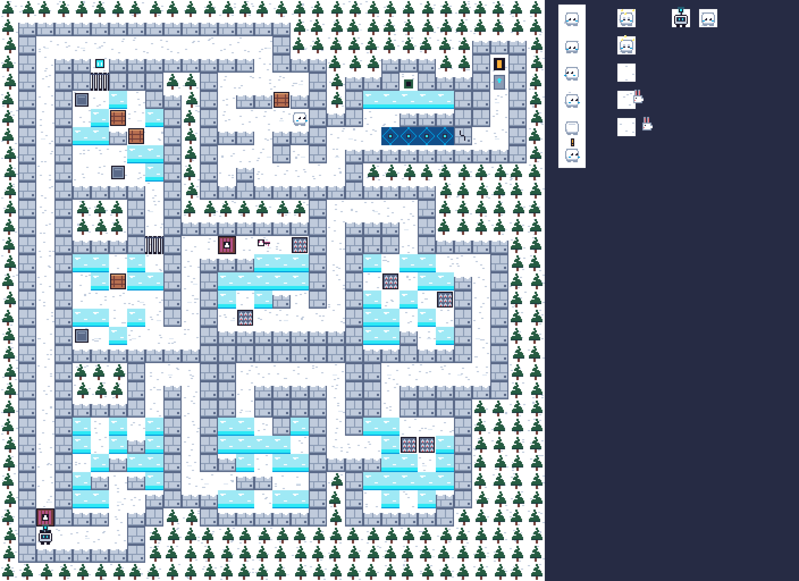 | `ice_map_draft.png`：冰原整張地圖的草稿 |
| 冰原（2） | 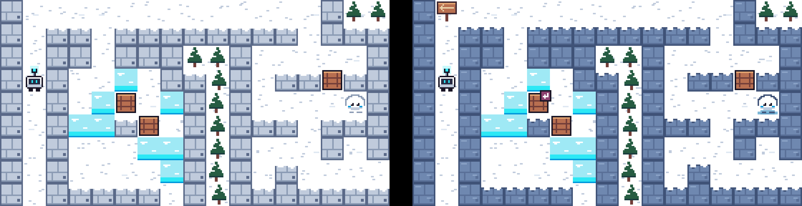 | `ice_contrast_v2.png`：冰牆改版前後的對比（左舊右新），畫的是實際冰原地圖的一角 |
| 沙漠（3） | 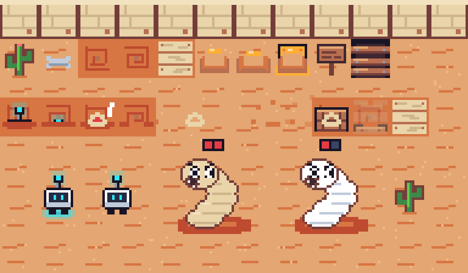 | `desert_art_preview.png`：沙地、岩石、仙人掌、流沙、沙橋、移動沙丘、壓力板、陷進流沙的動畫、箱子沉下變沙橋、沙蟲王 |
| 森林（4） | 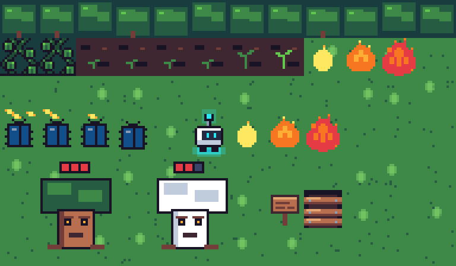 | `forest_art_preview.png`：樹冠、藤蔓、燒掉的藤蔓、吐火、甲蟲、老樹精 |
| 沼澤（5） | 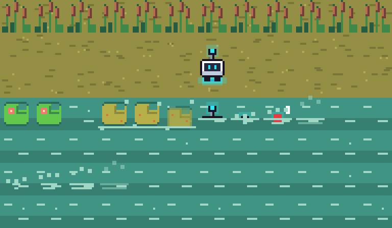 | `swamp_art_preview.png`：泥地、深水、蘆葦、綠睡蓮和黃睡蓮（會沉）、小光沉下去的動畫、水泡 |
| 礦坑（6） | 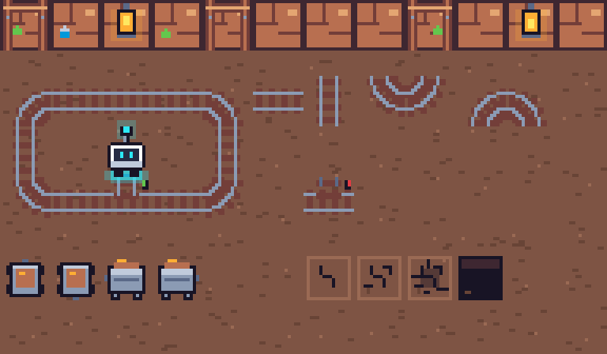 | `mine_art_preview.png`：礦坑地面、木樑、油燈、直軌、彎道、轉轍器、四個方向的礦車、崩塌地板四個階段 |
| 火山（7） | 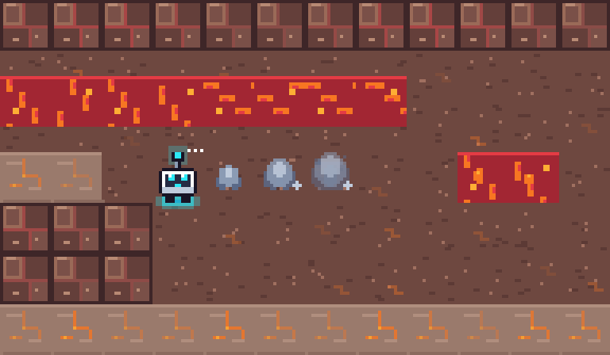 | `volcano_art_preview.png`：火山地面、四個方向的流動岩漿、岩漿池、冷卻熔岩、吐火沒效果時的灰煙、小光愣住的表情 |
| 海底（8） | 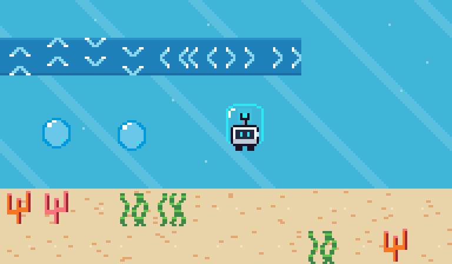 | `sea_art_preview.png`：海水、四個方向的海流、氣泡、戴泡泡頭盔的小光、珊瑚、海草、沙地 |
| 古堡（9） | 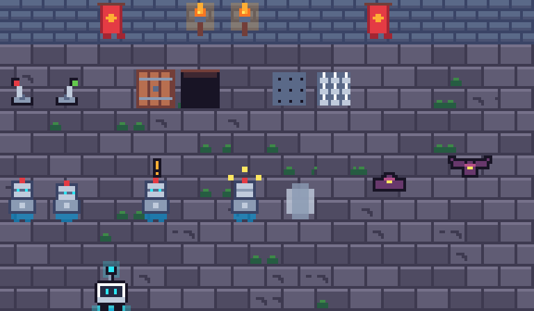 | `castle_art_preview.png`：磚牆、旗幟、火把、拉桿（開／關）、活板門、尖刺（升／降）、盔甲幽靈和被打倒的動畫 |
| 天空島（10） | 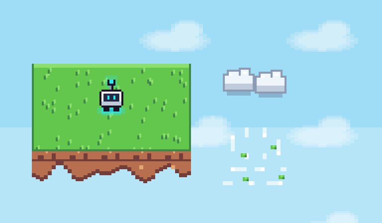 | `sky_art_preview.png`：天空、浮島地面和底部、雲朵平台、四個方向的風 |
| 鏡子迷宮（11） | 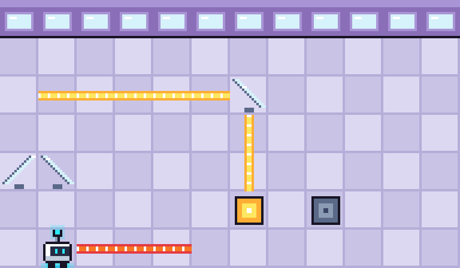 | `mirror_art_preview.png`：鏡子牆和地板、光線、兩種方向的鏡子、光靶（亮／暗）、火焰被鏡子反射 |
| 發電廠（12） | 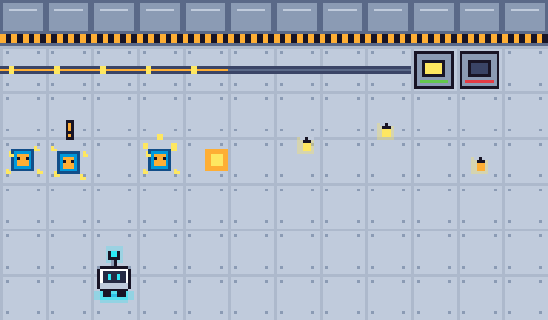 | `power_art_preview.png`：電線（有電／沒電）、發電機（開／關）、電火花怪和被打倒的動畫、螢火蟲 |
| 鐘塔（13） | 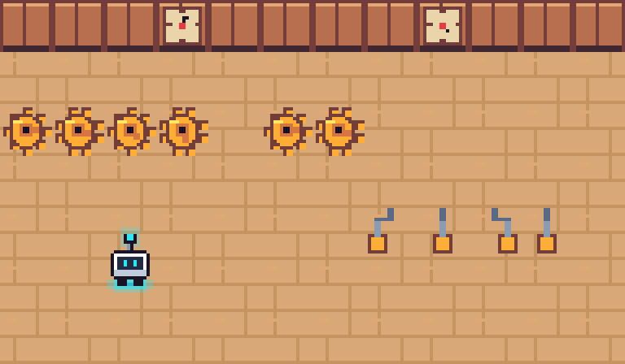 | `clock_art_preview.png`：鐘面、四個角度的齒輪、鐘擺擺動的四個階段（第一版） |
| 鐘塔（13） | 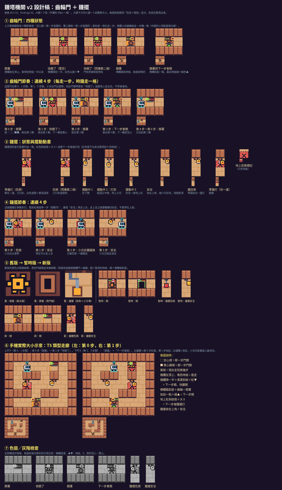 | `clock_mech_v2_design.png`：美術監督的鐘塔機關第 2 版（10-22 上線）。齒輪門「關、快開、開、快關」四種樣子和門上 4 顆節奏燈、鐘擺警示（下一步會打到的格子垂下來＋紅影）、舊版和新版對照、手機實際大小示意，以及色弱／灰階檢查 |
| 夜工廠（14） | 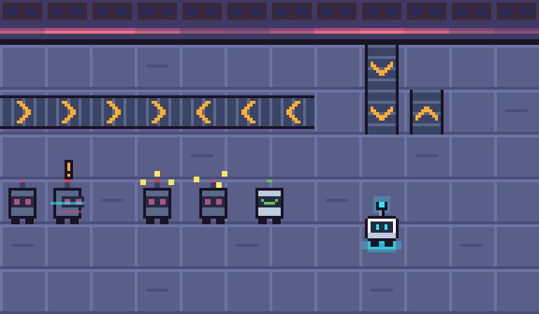 | `factory_art_preview.png`：工廠牆和地板、各方向的輸送帶、故障機器人和被打倒的動畫 |
| 核心（15） | 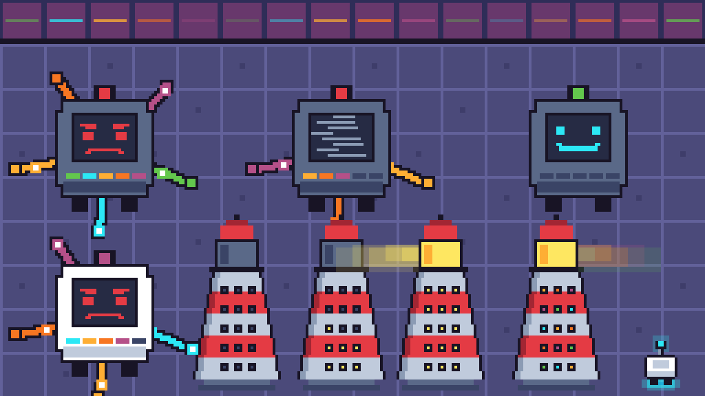 | `core_art_preview.png`：核心地板、故障核心各階段、燈塔亮 0／7／15 盞燈和全亮彩虹光的樣子 |

## 畫面元素

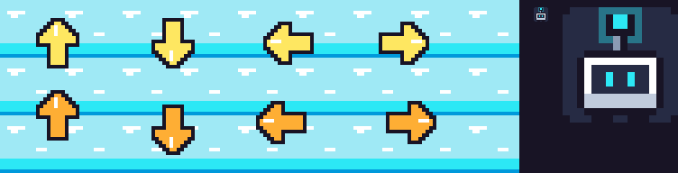

`guide_arrow_favicon.png`：剛進冰原時出現在冰上的四個方向引導箭頭（上下兩排是箭頭動畫的兩個時間點），右邊是網站分頁上的小光圖示（favicon）。

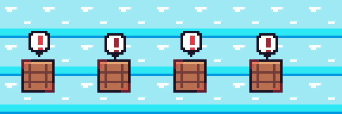

`stuck_box_preview.png`：箱子推到卡死時，箱子上會閃的「卡住」記號，四個動畫階段，背景是冰面。

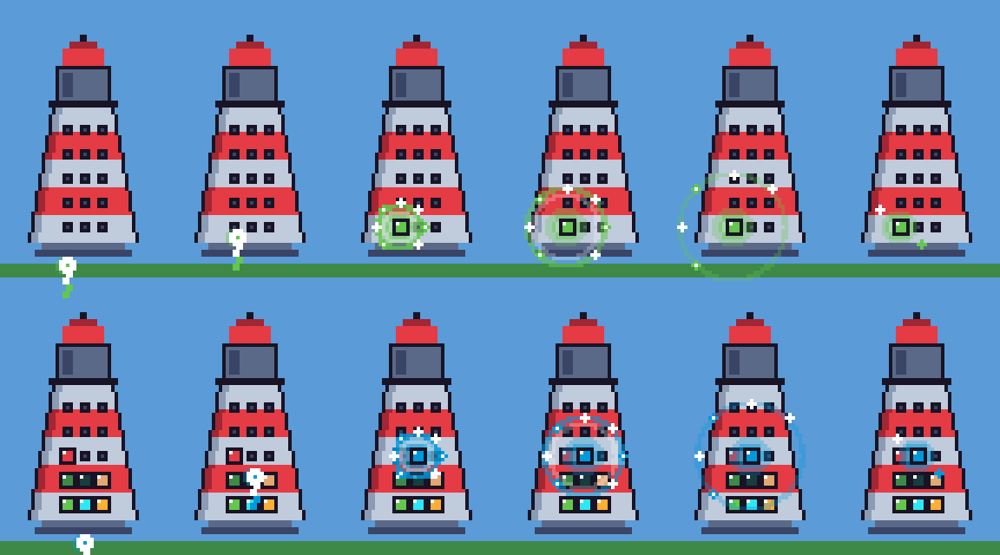

`lighthouse_lamp_on_preview.png`：拿到燈塔燈後燈塔亮起新一盞燈的動畫，各 6 格。上排是點亮第 1 盞燈，下排是已經亮了 7 盞、再點亮第 8 盞。

`lamp_colors_swatch.png`：15 個場景各自燈塔燈的顏色。

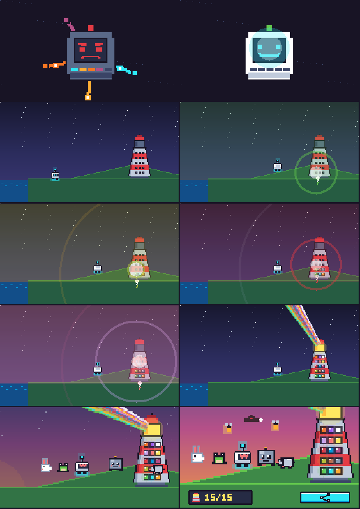

`ending_preview.png`：結局動畫的分鏡表，從開頭到最後依時間排列。

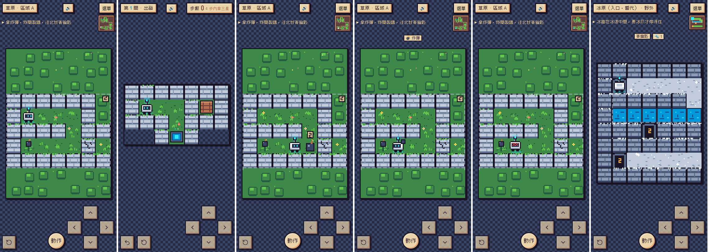

`world_preview.png`：草原大地圖模式早期的手機畫面（6 個畫面）。

### 設計稿（尚未放進遊戲）

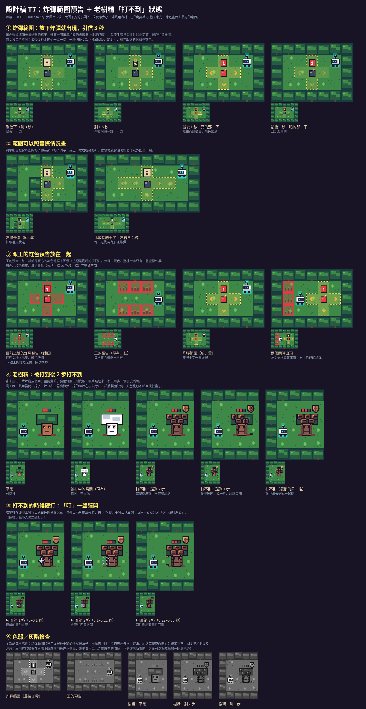

`bomb_range_treant_guard_design.png`：美術監督 10-23 的設計稿，Jasper 已同意這兩個方向，**但還沒放進遊戲**。
- **炸彈範圍預告**：放下炸彈就出現淡黃色（`#fee761`）十字和虛線框，每格有小箭頭往外；剩最後 1 秒才閃（一秒最多 2 下）。範圍會照實際情況被牆擋住；跟王的紅色預告放在一起也分得開。
- **老樹精「打不到」**：被打中後 2 步內身上長出樹皮鱗甲、右上角有小盾牌、顏色變暗；剩 1 步時鱗甲和盾牌裂開；這時打它會冒出「叮」的火花，木屑往攻擊方向彈回去。
- 最下面是色弱／灰階檢查。

## 上線截圖（`launch/`）

正式上線時各場景的實際遊戲畫面。檔名開頭的數字是場景編號。

| 圖 | 說明 |
|---|---|
| 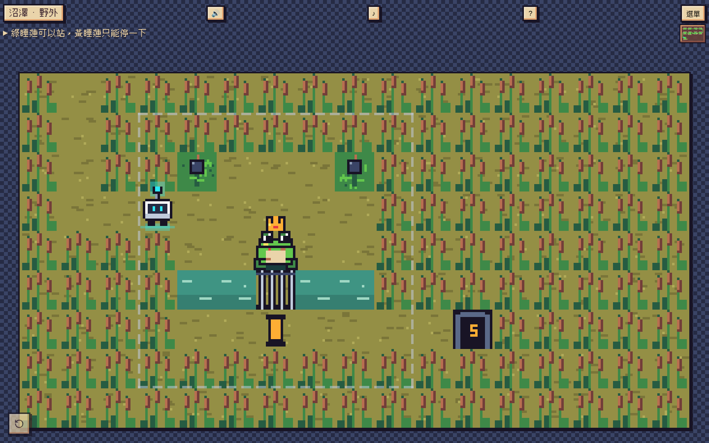 | 沼澤：泥巴蛙王的房間 |
| 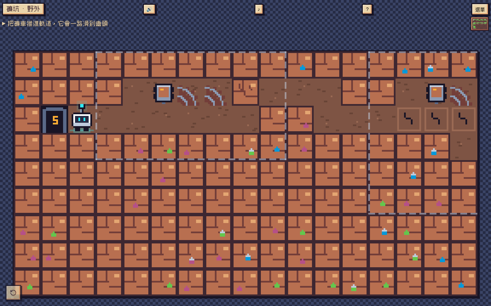 | 礦坑：礦車和軌道 |
| 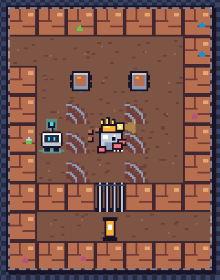 | 礦坑：鼴鼠王（王房特寫） |
| 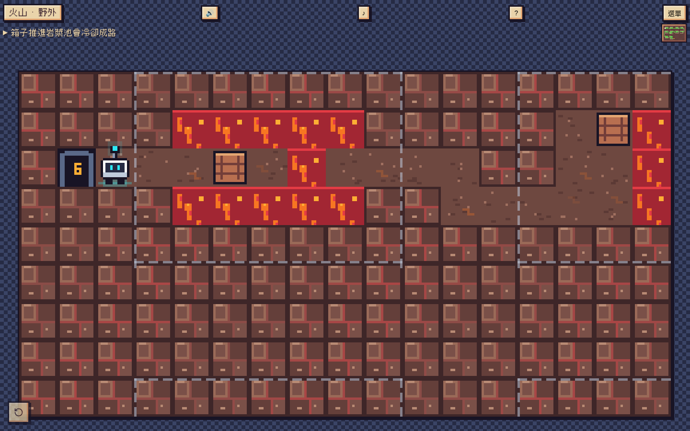 | 火山：岩漿 |
| 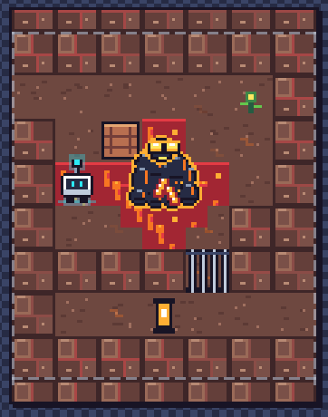 | 火山：熔岩巨人（王房特寫） |
| 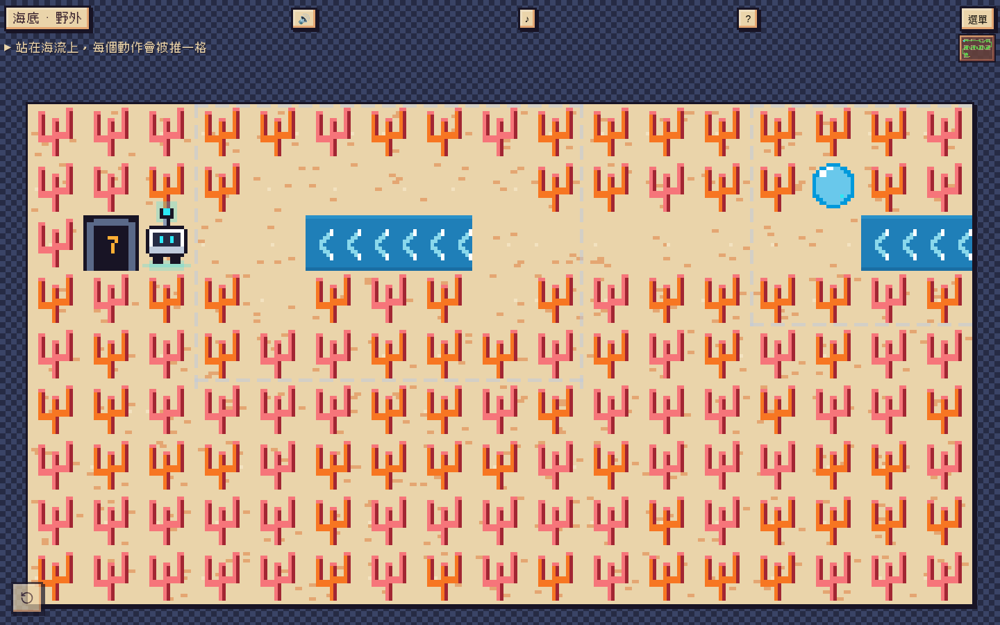 | 海底：海流 |
| 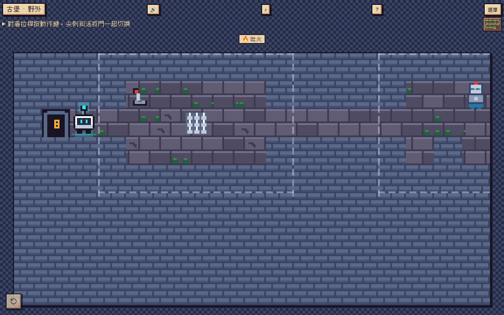 | 古堡 |
| 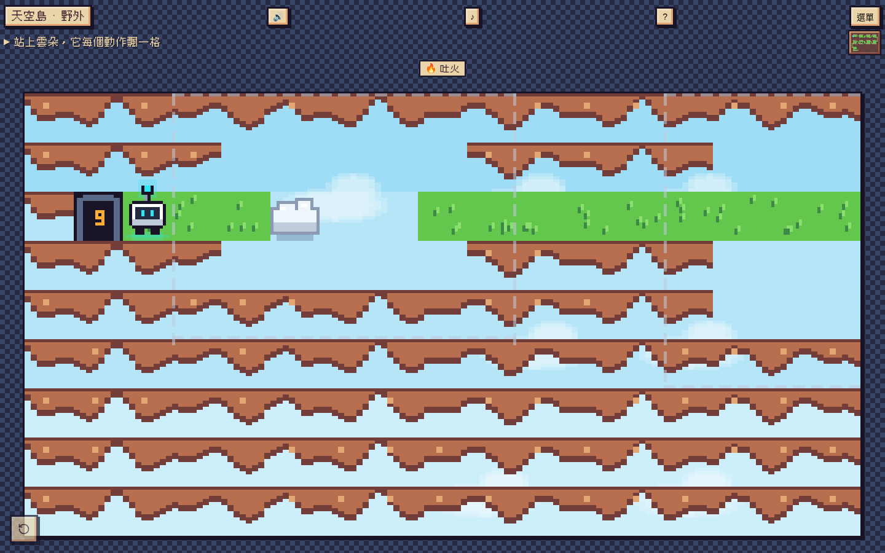 | 天空島：雲朵平台 |
| 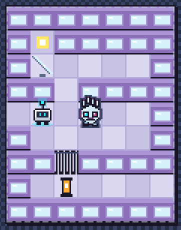 | 鏡子迷宮：鏡影王（王房特寫） |
| 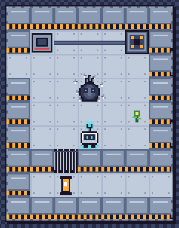 | 發電廠：電火花王（王房特寫） |
| 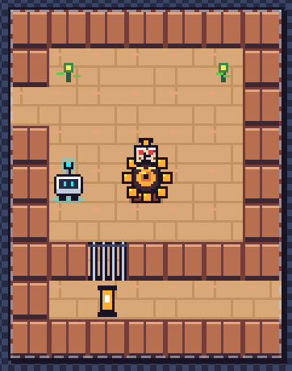 | 鐘塔：鐘塔守衛（王房特寫） |
| 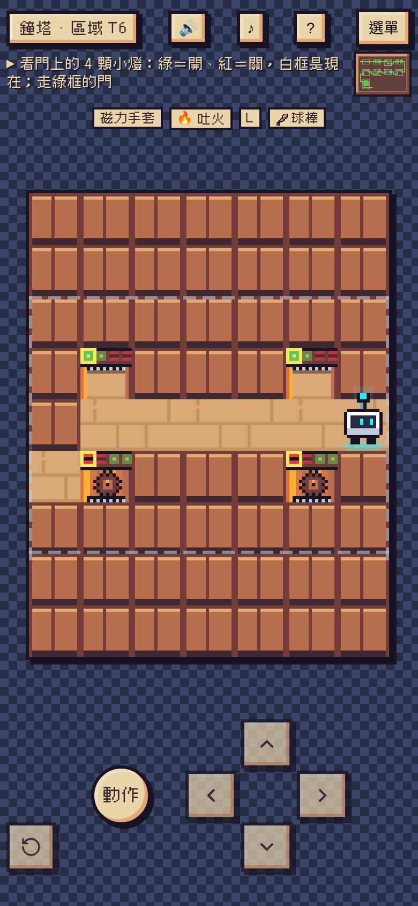 | 鐘塔 T6：第 2 版齒輪門上線後的手機畫面（直向走廊），美術監督用來確認開門、關門一眼分得出來 |

分享用的大圖（`og.png`、`og-clear.png`）已經在網站根目錄，這裡不重複存。

## 關卡修正說明圖（`levels/`）

Jasper 試玩卡關時做的說明圖：左邊（或上面）是舊版為什麼看不懂、過不去，右邊（或下面）是修好之後怎麼過。每張的修正內容見 [../CHANGELOG.md](../CHANGELOG.md) 同一天的紀錄。檔名開頭的數字是場景編號。

| 圖 | 區域 | 說明 |
|---|---|---|
|  | 鏡子迷宮 R6 | 加上黃色光線後：光從哪裡來、要翻哪一面鏡子（10-22 18:02） |
|  | 鏡子迷宮 R7 | 舊版箱子會卡在光的路上、推不回來；新版拿掉箱子，光要轉三個彎（10-22 18:02） |
|  | 鏡影王 RB | 舊版反射光打不到王；新版紅光（轉彎後的光）才打得到王，怎麼引王進紅光（10-22 18:30） |
|  | 發電廠 P5 | 發電機、電門、斷線改畫前後對照，和新版的走法（10-22 19:35） |
|  | 鐘塔 T5 | 黃色太陽＝關著的齒輪門、掛鉤＝鐘擺；新版每個東西都看得出「下一步」會怎樣（10-22 20:46） |
|  | 夜工廠 F5 | 開關像灰色鐵塊、還有陷阱箱；新版開關、電線、門燈和走法（10-22 21:27） |
|  | 核心 C4 | 舊版要等巡邏機器人；新版用帶子送箱子壓開關，20 步不用等（10-22 21:58） |
|  | 核心 C10 | 從 Jasper 截圖的位置一步一步怎麼過（31 步，不用等、不用撞牆）；這一區沒有改 |

## 美術原始檔

- 已經上線的美術程式就在 repo 根目錄：`art.js`（共用色票、小光、箱子、開關、音效，由 `game.js` 產生）、`ice-art.js`、`desert-art.js`、`forest-art.js`、`swamp-art.js`、`mine-art.js`、`volcano-art.js`、`sea-art.js`、`castle-art.js`、`sky-art.js`、`mirror-art.js`、`power-art.js`、`clock-art.js`、`factory-art.js`、`core-art.js`、`ending-art.js`。這些就是遊戲實際在用的版本，這裡不再複製一份，免得兩邊不一樣。
- 棒球棒（`bat-art.js`）和鐘塔第 2 版機關（`clock-mech-art.js`）也已經上線，同樣在根目錄。
- 還沒接進遊戲的美術原始檔（例如炸彈範圍預告、老樹精打不到狀態）放在開發資料夾，接進遊戲後才會出現在根目錄。

## 產生設計圖的程式（`tools/`，在開發資料夾）

這些程式**目前不在這個 repo 裡**，要在開發資料夾的 `tools/` 裡執行（例如 `node tools/bat-art-preview.js`）。它們會從上一層讀 `art.js` 和各場景的 `*-art.js`，輸出到 `shots/`。不需要瀏覽器，也不用額外安裝套件；只有輸出對比圖的幾支會用到 Python 的 Pillow。

| 程式 | 產生 |
|---|---|
| `biome-art-preview.js` | 各場景設計表（沙漠、森林、沼澤、礦坑、火山、海底、古堡、天空島、鏡子迷宮、發電廠、鐘塔、夜工廠、核心）。也是其他程式共用的小畫布和 PNG 輸出工具 |
| `bat-art-preview.js` | 棒球棒設計表和 16／32px 圖示 |
| `boss-preview-567.js`、`boss-preview-8910.js`、`boss-preview-111213.js`、`boss-preview-1415.js` | 各組迷你王設計表 |
| `knight-1x-preview.js` | 騎士 1 倍和 2 倍對照 |
| `mirror-king-contrast-preview.js` | 鏡影王改版前後對比（需要舊版參考檔 `tools/mirror-art-before-ref.js`，那個檔沒有存進來） |
| `lava-giant-rim-preview.js` | 熔岩巨人外框檢查 |
| `ice-contrast-preview.js` | 冰牆改版前後對比（需要開發資料夾的 `world/ice.txt` 和舊版參考檔 `tools/ice-art-old-ref.js`，參考檔沒有存進來） |
| `stuck-box-preview.js` | 箱子卡住提示 |
| `lamp-preview.js` | 燈塔亮燈動畫 |
| `ending-preview.js` | 結局分鏡表 |
| `guide-favicon-preview.js` | 引導箭頭和網站小圖示。⚠ 執行時會**覆蓋**根目錄的 `favicon.ico` 和 `favicon-32.png` |
| `og-preview.js` | 分享大圖和燈色表 |
| `clock-mech-preview.js` | 鐘塔第 2 版機關設計稿 |
| `bomb-treant-preview.js` | 炸彈範圍預告和老樹精打不到狀態設計稿 |
