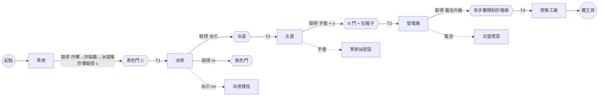

# Glowbot 小光：大地圖冒險規劃

## 1. 地圖總覽

鏡頭跟著小光捲動。每個謎題區不超過 7×8，手機上一眼看得完；謎題區之間用走廊連起來。

| # | 地圖 | 大小（寬×高） | 主題 | 本區取得的道具 | 傳送台 |
|---|---|---|---|---|---|
| 1 | 草原 | 25×25（已畫好：world/grass.txt） | 入門：炸彈、裂牆、箱子、開關、小冰湖 | 炸彈（第一個道具）、青色鑰匙 c | 草原中央 |
| 2 | 冰原 | 28×28 | 滑冰、尖刺、崩塌地板 | 冰爪 ❄️（站在冰上不會滑）、紫色鑰匙 m | 冰湖小屋 |
| 3 | 古堡 | 30×28 | 鑰匙門、箱子 | 磁力手套 🧤 g、粉紅鑰匙 n | 古堡大廳 |
| 4 | 發電廠 | 28×28 | 有步數限制的區域、電池 | 電池升級 🔋（步數上限永久 +10） | 控制室 |
| 5 | 夜晚工廠 | 32×30 | 巡邏機器人，全部道具混合 | 魔王房 | 工廠入口 |

## 2. 隧道連接與道具門檻

| 隧道 | 從 → 到 | 需要 |
|---|---|---|
| T1 | 草原北洞口 → 冰原南 | 青色門 C（草原取得的 c） |
| T2 | 冰原東冰窟 → 古堡西 | 冰爪（洞口前是滑不停的冰道） |
| T3 | 古堡地下道 → 發電廠 | 粉紅門 N + 磁力手套（要拉出擋路的箱子） |
| T4 | 發電廠電梯 → 夜晚工廠 | 電池升級（電梯前的通道有步數限制，原本的步數走不到） |
| 回頭路 R1 | 草原東：有手套才能拉開的箱子 → 草原祕密區（零件） | 磁力手套 |
| 回頭路 R2 | 冰原北：冰湖中央的平台 → 紫色門後的捷徑 | 冰爪 + m |
| 回頭路 R3 | 古堡塔頂：需要拉箱子的開關謎題 → 零件 | 電池升級 |

說明：
- 前 10 分鐘是一條直線：從草原起點開始，經過 3 個謎題房拿到 c，再回頭開第一扇青色門。
- 隧道是雙向的，走回去就回到原地圖對應的洞口。
- 每張地圖第一次到時，傳送台會自動啟用。

## 2.5 炸彈規則（已定案）

- **裂牆 `%`**：只有裂牆能被炸開。
- **炸彈草 `b`**：一次只能帶 1 顆。拿走後會再長出來，所以炸彈永遠用不完。
- **一顆動作鍵**：面向炸彈草按，就是拿炸彈；身上有炸彈時按，就把炸彈放在面前那一格。
- **放下的炸彈像箱子**：可以推，在冰上會一直滑。放下後機器人再走 3 步就爆炸。
- **爆炸範圍是十字**：炸彈那一格加上下左右 4 格。範圍內的裂牆會被炸掉；機器人在範圍內就失敗。
- **強冰 `J`**：穿著冰爪也會滑。

**之後再回來的裂牆：**
- 草原：裂牆後藏著零件，要從冰湖區帶炸彈回來炸。可以再加一處「要有手套才拉得開的箱子」擋住的裂牆。
- 冰原：在強冰 `J` 的冰道盡頭放裂牆，要先拿到冰爪，才能把炸彈推到正確的位置。

## 3. 道具取得順序

💣 炸彈（草原開頭）→ 青色鑰匙 c（草原後段，冰湖炸彈謎題）→ 冰爪（冰原）→ 紫色鑰匙 m（冰原）→ 磁力手套（古堡）→ 粉紅鑰匙 n（古堡）→ 電池升級（發電廠）→ 魔王房（工廠）

畫面上方的提示字會照這個順序顯示下一個目標，例如「拿到冰爪 → 往東邊的冰窟」。

## 4. 進度圖



## 5. 各地圖的謎題區（沿用 levels.js 的關卡）

| 地圖 | 謎題區（括號裡是原本的關卡編號） | 改編重點 |
|---|---|---|
| 草原 | A 出發(1)、B 繞圈圈(4)、C 第一個箱子(5)、D 箱子與開關(2)、E 雙開關(6)、F 冰湖炸彈（新做）| 已畫好並驗證，見 world/grass.txt、world/check.js |
| 冰原 | 初次滑冰(7)、冰上折返(8)、小心陷阱(9)、冰湖迷途(10)、冰上推箱(11)、冰原終章(12)、冰面滑行(3) | 第 12 關改成冰爪所在的房間；第 3 關的 c/C 換成 m/M；加入崩塌地板 O |
| 古堡 | 青色鑰匙(13)、兩把鑰匙(14)、冰上取鑰(15)、箱子後的鑰匙(16)、雙色冰窟(17)、鑰匙終章(18)、磁力手套(26) | 第 26 關搬到這裡當手套房；第 15、17 關要有冰爪才走得到 |
| 發電廠 | 省電模式(19)、兩顆電池(20)、電力推箱(21)、冰上充電(22)、電池與鑰匙(23)、能源終章(24) | `limit=` 只在該謎題區裡有效；第 24 關的電池升級放在終點；原本當誘餌的紫色鑰匙可以拿掉 |
| 夜晚工廠 | 巡邏員(25)、雙巡邏(27)、巡邏冰道(28)、手套與巡邏(29)、大魔王迷宮(30) | 第 30 關擴大成魔王房（最大 7×10） |

拿到冰爪後，冰原上已經解過的謎題不需要重新驗證，因為冰爪只會讓玩家多出選擇。之後的世界如果有一定要靠滑冰才能過的謎題，一律用強冰 `J`（已定案）。

## 6. 資料格式（依網頁開發工程師的格式）

**地圖**：每張地圖是一個文字格子，圖例跟 levels.js 一樣。隧道口用數字 `1`–`9` 標示。

**隧道規則**：同一個數字就是互通的一對隧道口。數字在整個世界裡只能用一次，每個數字剛好出現在兩個口，可以在同一張圖，也可以在不同圖。這樣最多有 9 對，目前規劃只用到 7 對，夠用，也不會因為兩張圖用了同一個數字而搞混。解題程式會檢查每個數字是不是剛好出現兩次。

| 數字 | 洞口 A（地圖, 行, 列） | 洞口 B（地圖, 行, 列） | 需要 |
|---|---|---|---|
| 1 | 草原, 1, 14 | 冰原, 27, 5 | 青色門 C（放在洞口前） |
| 2 | 冰原, 10, 27 | 古堡, 12, 1 | 冰爪 |
| 3 | 古堡, 27, 15 | 發電廠, 1, 14 | N 門 + 手套 |
| 4 | 發電廠, 14, 27 | 夜晚工廠, 1, 4 | 電池升級 |
| 5 | 草原, 12, 12 | 古堡, 14, 15 | 傳送台捷徑（到過才啟用） |
| 6 | 冰原, 14, 14 | 發電廠, 14, 2 | 傳送台捷徑 |
| 7 | 草原, 20, 26 | 草原, 3, 26 | 祕密洞穴（R1，在同一張圖裡） |

說明：行、列從 1 開始算。傳送台也用隧道的方式來做，平常鎖著，到過一次才打開。

**謎題區**：每個謎題區是一個長方形，寫法例如「區域 A：第 3–10 行、第 5–11 列」，大小最多 8 行 × 7 列。按重設時只會恢復這個長方形裡的格子，包括箱子、門、崩塌地板和巡邏機器人。

```
草原
區域 A（原第 1 關）：第 17–20 行、第 3–9 列
區域 B（原第 4 關）：第 9–16 行、第 3–9 列
...
```

每個區域可以另外設定 `limit=N`，步數限制只在這個區域裡有效。

**道具欄**：所有地圖共用同一個道具欄，道具、鑰匙和零件到哪張圖都帶著。鑰匙開門後不會用掉。

**新增的圖例**：
- `W` 傳送台
- `R` 符文石：提醒「之後再回來」，只是裝飾
- `J` 強冰：穿冰爪也會滑
- `k` 冰爪
- `U` 電池升級

**存檔**：存在 localStorage，內容包括地圖、座標、道具欄、已開的門、已拿的零件、已解開的區域。每進一個區域或隧道就存一次。

## 7. 解題程式怎麼驗證整個世界

1. **分兩層檢查。** 第一層是謎題區：用原本的 solve.js 對每個長方形區域單獨求解，要列出所有「入口 × 出口 × 持有道具組合」，確認每一種組合都過得去，並記錄最少步數。第二層是世界圖：每個謎題區縮成一個節點，邊上寫著需要的道具，數字隧道也是邊。
2. **用狀態搜尋證明能破關。** 狀態是（目前位置所在的節點，道具集合）。從起點跑 BFS，確認能拿到所有道具並走到魔王房。
3. **檢查有沒有軟鎖。** 對每一個走得到的狀態，都再確認從那裡還能走到魔王房；只要有一個走不到，就回報那條路徑。
4. **讓重設功能保證謎題區本身不會卡死。** 因為按重設一定會把謎題區恢復原狀，所以箱子卡住不算軟鎖。真正要擔心的只有離開謎題區後回不來的單向路，例如崩塌地板。
5. **其他檢查：**
   - 前 10 分鐘的路線只有一條（第一個道具之前，分支數 = 1）
   - 每個門檻前面一定有提示字和符文石
   - 每個傳送台都走得到
   - 所有零件都拿得到

輸出一份報告：每個區域的最少步數、道具取得順序，以及全收集最少要走幾步。

## 8. 冰原設計稿（world/ice.txt，2026-10-15）

- 大小 28 欄 × 30 行（比原規劃多 2 行，讓 9 個 7×8 謎題區之間都有走廊）。
- 隧道 1 的冰原端在第 29 行、第 2 列（取代第 6 節表格裡的「27, 5」）；隧道 2 在第 3 行、第 27 列，前面第 4 行、第 27 列有符文石 R 擋住，要之後的道具才能移開。
- 傳送台 6 先不放（數字必須剛好出現兩次，發電廠還沒有圖）。
- 路線：A(7) → B(8) → C(9) → D(10) → E(3，拿紫鑰匙 m) → F(11) → G(12，出口拿冰爪 k) → H 雪球巡邏（新）→ I 強冰炸彈（新）→ 符文石 / 隧道 2。
- 回程捷徑：G 的出口上方走廊（第 2 行）往西、沿第 2 列往南，穿過紫門 M（第 28 行、第 2 列）回到隧道 1。
- G 區改了一格：第 6 行、第 7 列的冰改成雪地。大地圖規則裡箱子會在冰上滑，原本的第 12 關會變成無解。
- H 區（雪球巡邏）：巡邏怪 P 在第 6 行左右來回。把上面的箱子推進走廊，巡邏怪碰到箱子會折返，被困在右邊。不用炸彈；算準時機偷溜過去也可以（14 步用箱子，10 步偷溜）。
- I 區（強冰炸彈）：炸彈草在一排普通冰的中間，沒有冰爪停不下來（解題程式確認沒冰爪無解）。拿到炸彈後，把它放在強冰 J 上推出去，炸彈滑到裂牆前，炸開出口。

### 驗證（/tmp/ice/check-ice.js、/tmp/ice/whole.js：依 check.js 的逐步規則擴充）
- 炸彈引信設為 6 步（3 秒 × 每秒最多 2 步），另外加一個「等待」動作：時間會過去，但巡邏怪不動（即時炸彈的模型）。
- 各區最少步數：A 8、B 11、C 12、D 13、E 6、F 17、G 28、H 14（有冰爪）、I 16（有冰爪）。
- 整張圖：從隧道 1 到符文石前最少 214 步（要拿到 k 和 m），可到達狀態 159,926，軟鎖 0。
- 回程捷徑：從符文石走回隧道 1 要 61 步。

### 需要的引擎改動（world-engine.js / world.js，由工程師做）
1. 巡邏怪 `P` 接到大地圖模式。沿用 logic.js 的左右來回路線，每走一步（包括撞牆、按動作）巡邏怪也走一步；等待不動。碰到機器人 = 失敗，該區重設。
   - 前方是箱子或炸彈時折返；兩邊都被擋就停在原地。
   - 在爆炸範圍內就被打倒，播「暈眩→變雪兔跑走」動畫。
   - 重設和離開區域時，巡邏怪回到初始位置。
2. 紫鑰匙 `m` / 紫門 `M`、冰爪 `k`，以及冰爪讓普通冰 `I` 停住、強冰 `J` 照樣滑。這幾項目前大地圖已支援，要確認 ice 主題的圖塊。
3. 箱子不能推出自己的區域：推到區域邊界外就當作被擋住。解題程式已照這條規則檢查；有兩處門口（F 區右邊、G 區下方）沒有這條規則的話，箱子會被推出去。
4. 符文石 R 前的隧道 2：要有之後的道具才能清掉 R（目前 R 永遠是實心）。
5. 冰原美術：tools/ice-art-draft.js（雪地、普通冰、菱形強冰、頂端積雪的岩牆、地圖外的雪松、雪球怪 2 格走路、看見機器人時的「!」、打倒動畫）。預覽：shots/ice_map_draft.png。
6. build-world.js 要換掉 ice STUB，改讀 world/ice.txt（區域格式跟 grass.txt 一樣）。

## 9. 沙漠設計稿（world/desert.txt，2026-10-15）

- 41 欄 × 39 行，13 個謎題區＋沙蟲王，蛇形排列（每排 4 區，偶數排由右往左，區域左右翻轉）。每區 7 欄寬、有自己的外牆，只在入口（E）和出口（Q）開口。
- 隧道 2（第 5 行、第 2 列）接冰原隧道 2；隧道 3（王關後面）接森林。冰原那端的隧道 2 原本寫「古堡（待定）」，改成接沙漠。
- 新字元：`q` 流沙、`=` 沙橋、`<` `>` `^` `v` 移動沙丘（字元＝一開始的方向）、`Y` 沙蟲王、`G` 王關門、`L` 燈塔燈。其餘沿用 grass/ice（`B` 箱子、`b` 炸彈草、`%` 裂牆、`X` 開關、`D` 開關門）。

### 規則（逐步；炸彈照第 2.5 節改成即時，解題模型見第 11 項）
1. **流沙 q**：機器人走進去＝陷下去（失敗，該區重設）。箱子推進去會沉下去，那格變成**沙橋 =**（永久可走）。炸彈推進去會沉掉（不會爆）。沙丘走進去也會沉下去變沙橋。巡邏怪、沙蟲王不會進流沙（當作牆）。
2. **移動沙丘**：實心、推不動。機器人每做一個動作（走、撞牆、按動作鍵）它就沿自己的方向走一格；前面是牆、裂牆、炸彈草、箱子、炸彈、別的沙丘、機器人、入口/出口格、道具、或關著的門，就**原地掉頭**（這一步不動）。順序：機器人先動，沙丘再動，所以沙丘不會壓到機器人。等待（只讓時間過去）時沙丘不動。
3. 沙丘壓在開關 X 上也算壓住（很重）。開關門 D 只在「這區所有 X 都被箱子或沙丘壓住」時打開；機器人站在門上時門不會關。
4. 炸彈爆炸（十字）會**炸散沙丘**，也照舊炸開裂牆、炸到機器人＝失敗。火（森林道具）不影響沙丘。
5. **沙蟲王 Y（迷你王）**：在王關裡左右來回走，規則跟沙丘一樣，**但炸彈擋不住牠**（牠會走到炸彈上）。被爆炸十字掃到一次扣 1 血，共 2 血。歸零後王關門 G 打開，後面的燈塔燈 L 走過去就點亮（拿到才算過關）。王關裡有兩叢炸彈草。

### 各區（最少動作數，含按動作鍵）
| 區 | 新東西 | 最少 |
| D1 | 流沙教學：箱子推進流沙變橋 | 6 |
| D2 | 兩格流沙，兩個箱子要照順序 | 20 |
| D3 | 抱著炸彈過沙橋，炸開出口的裂牆（炸彈推進流沙會沉掉） | 14 |
| D4 | 移動沙丘教學：你走一步它才走一步，站著等它不會動（1 格寬直向沙丘路，跟著它的節奏穿過） | 6 |
| D5 | 沙丘自己走進流沙變成橋 | 10 |
| D6 | 走廊中間只有一個小凹槽可以躲沙丘 | 11 |
| D7 | 關著的門也擋得住沙丘：把箱子推上開關開門，沙丘才穿過門、沉進流沙鋪出通往出口的橋（拿掉箱子或沙丘都無解） | 9 |
| D8 | 1 格寬走廊的沙丘只能炸掉 | 14 |
| D9 | 箱子擋在沙丘的路上：把箱子推進旁邊凹槽，沙丘才走得到流沙、沉下去鋪橋（箱子推不到流沙，拿掉沙丘無解） | 13 |
| D10 | 用箱子把沙丘卡在開關上：沙丘只經過開關一次就會沉進流沙，要在它踩著開關時把箱子推進它身後；門離開關很遠，只算時機一定來不及（箱子當牆時無解） | 11 |
| D11 | 先用一個箱子鋪橋，再把另一個箱子推過橋壓開關 | 21 |
| D12 | 裂牆關著沙丘：炸開裂牆放沙丘出來，讓它沉進流沙鋪橋；炸彈放太近會把沙丘一起炸散（拿掉沙丘或炸彈草都無解） | 23 |
| D13 | 大考：鋪橋＋箱子壓開關＋躲沙丘 | 21 |
| 沙蟲王 | 預判沙蟲王的路線放炸彈，炸兩次 | 20 |

## 10. 森林設計稿（world/forest.txt，2026-10-15）

- 41 欄 × 35 行，13 個謎題區＋老樹精，排法同沙漠。隧道 3（第 5 行、第 2 列）接沙漠，隧道 4（王關後面）接沼澤（待定）。
- 新字元：`w` 藤蔓、`a` 灰燼（燒掉的藤蔓）、`f` 吐火、`K` 冰塊、`z` 甲蟲（先往右）、`Z` 甲蟲（先往左；翻轉的區域用）、`y` 甲蟲（先往下）、`T` 老樹精、`G` 王關門、`L` 燈塔燈。

### 規則
1. **吐火 f**：F1 撿到，之後一直帶著。按動作鍵的優先順序：面對炸彈草且手上沒炸彈→撿炸彈；拿著炸彈且面前可以放→放炸彈；都不是而且有吐火→吐火。吐火算一個動作（會動的東西會走一步）。
2. **火焰**：從面前那格往前直直飛，經過空地/灰燼/流沙/沙橋/開關，碰到**第一個**東西就停：
   - 藤蔓 w：燒掉變灰燼 a，停。
   - 冰塊 K：融掉變地板，停。
   - 甲蟲：**嚇呆 3 步**（3 個動作不動），停。
   - 老樹精 T：扣 1 血，停。
   - 牆、**裂牆（火燒不開，要炸彈）**、炸彈草、箱子、炸彈、關著的門：直接停，沒效果。
3. **藤蔓會長回來**：燒掉後 6 個動作長回來；那時灰燼上有機器人、箱子、炸彈或甲蟲就先等，空出來馬上長回來。藤蔓是實心的，甲蟲、箱子都過不去。
4. **甲蟲**：每個動作走一格，被擋就掉頭（原地）。機器人走進甲蟲或甲蟲走進機器人＝失敗。入口、出口格是安全格（甲蟲不會進去）。炸彈爆炸會打倒甲蟲。
5. **老樹精 T（迷你王）**：不會動，3 血，四周是藤蔓。每被火打中一次：扣 1 血，而且**全區燒掉的藤蔓立刻全部長回來**（要重新開路）。歸零後變地板，王關門 G 打開，去拿燈塔燈 L。
6. 炸彈只炸裂牆、甲蟲、（沙漠的）沙丘；不燒藤蔓、不融冰。火不能代替炸彈。

### 各區（最少動作數；「要火」＝不帶吐火無解）
| 區 | 新東西 | 最少 | 要火 |
| F1 | 撿到吐火，燒掉擋路的藤蔓 | 7 | — |
| F2 | 從遠處隔著流沙點火（繞路太久藤蔓會長回來，要再燒一次） | 11 | 要 |
| F3 | 火只燒到第一根藤蔓 | 9 | 要 |
| F4 | 冰塊：火會融掉 | 10 | 要 |
| F5 | 甲蟲教學（躲進凹槽） | 9 | 不用 |
| F6 | 用火把甲蟲嚇呆 3 步（不用火也能硬算時機） | 8 | 不用 |
| F7 | 藤蔓擋著炸彈草；出口是裂牆，火燒不開，要炸彈 | 16 | 要 |
| F8 | 先燒藤蔓才推得動箱子上開關（太慢藤蔓會長回來） | 19 | 要 |
| F9 | 炸彈打倒甲蟲 | 13 | 不用 |
| F10 | 融掉冰塊，把箱子推上開關 | 17 | 要 |
| F11 | 兩隻甲蟲 | 10 | 不用 |
| F12 | 把凹槽的藤蔓燒掉，躲進去讓甲蟲過去（站在灰燼上藤蔓長不回來） | 13 | 要 |
| F13 | 大考：冰塊、甲蟲、箱子、開關 | 13 | 不用（有火比較短） |
| 老樹精 | 燒開一根藤蔓再打它，每打一次藤蔓全長回來，要重新燒開 | 13 | 要 |

## 11. 驗證（world/check-new.js，獨立程式，不用 world-engine.js）
- 用法：`node world/check-new.js [desert|forest|all]`；`SHOW=D7` 印出該區最短路線；`FUSE_N`（預設 4）、`REGROW`（預設 6）可調。
- 炸彈模型：放下後最多 FUSE_N 個動作就爆；另有「等待」動作（時間過去但沙丘、甲蟲、沙蟲王都不動）。
- 每區從入口獨立求解（森林從 F2 起帶著吐火），列舉全部可達狀態，回報最少步數、不按「重來」就出不去的死路狀態數（都能用「重來」回到開頭，所以軟鎖＝0），並檢查「不帶火能不能過」。
- 大地圖：檢查隧道→第 1 區入口、每區出口→下一區入口、王關出口→下一個隧道都有走廊連通，且每區不超過 7 欄。
- 結果（2026-10-15）：沙漠 14 區、森林 14 區全部可解，軟鎖 0；謎題步數合計沙漠 199、森林 168。
- 必要性測試（/workspace/robot-maze-scratch/new/variants.js）：D7 拿掉箱子或沙丘、D9 拿掉沙丘、D10 拿掉箱子或沙丘或把箱子固定、D12 拿掉沙丘或炸彈草，全部變成無解。

## 12. 沼澤、礦坑、火山設計稿（world/swamp.txt、mine.txt、volcano.txt，2026-10-15，網頁開發工程師）

- 三張圖都是 43 欄，11 個謎題區＋1 個王關，蛇形 3 排 × 4 區（第 2 排由右往左，區域左右翻轉）。每區 7 欄寬，只在入口和出口開口。
- 檔案用 `node tools/scenes567/gen.js` 從 `tools/scenes567/spec.js` 產生，所以**請改 spec.js 再重新產生**，不要直接改 .txt。
- 隧道接續森林的編號：4＝森林↔沼澤，5＝沼澤↔礦坑，6＝礦坑↔火山，7＝火山↔海底。海底還沒有圖，所以隧道 7 目前只出現一次，要像以前的隧道 2 一樣放進 `pendingTunnels`。
  - ⚠ 第 6 節原本把 5、6、7 留給傳送台和祕密洞穴，但地圖上從來沒放過。15 個場景之間要 14 條隧道，數字 1–9 不夠用。引擎要改成支援兩位數或字母的隧道編號。
- 美術完全照美術監督的 swamp-art.js、mine-art.js、volcano-art.js 設計。
- 道具會帶到下一張圖：沼澤、礦坑一進來就帶著吐火；火山裡吐火沒有效果。

### 12.1 沼澤（地圖 5）

新機關（2 個）：
1. **深水 `~`**（swampWater）：不能走。箱子或炸彈推進去會沉掉，不會變成路（沒有浮箱的圖）。甲蟲和蛙王都不會進水。火焰會飛過水面。
2. **睡蓮**（lilyPad）
   - `p` 綠睡蓮（sinking=false，有粉紅花）：永遠安全，跟地板一樣。
   - `l` 黃睡蓮（sinking=true，有斑點和氣泡）：
     - 走上去後，最多只能停 1 個動作（撞牆或按動作鍵）。第 2 個動作還站在上面，就會沉下去（失敗，robotSwampSink）。
     - 離開後它馬上沉掉，變成深水 `~`（sinkT 動畫）。
     - 「等待」不算動作。
     - 箱子壓在上面不會沉。

沿用的機關：炸彈、裂牆、箱子、開關門、藤蔓＋吐火、水蛭（森林甲蟲的規則）。

| 區 | 內容 | 最少步數 |
|---|---|---|
| S1 | 綠睡蓮教學 | 6 |
| S2 | 黃睡蓮教學 | 6 |
| S3 | 黃睡蓮只能過一次，要先拿炸彈 | 12 |
| S4 | 只有中間的綠睡蓮能等水蛭過去 | 7 |
| S5 | 水蛭上下游，黃睡蓮上不能等 | 7 |
| S6 | 水蛭 | 8 |
| S7 | 吐火＋黃睡蓮 | 7（要火） |
| S8 | 燒藤蔓，推箱子上開關 | 10（要火） |
| S9 | 炸裂牆，睡蓮是退路 | 17 |
| S10 | 大考：箱子推過黃睡蓮壓開關 | 14 |
| S11 | 水蛭和箱子 | 12 |
| SB 泥巴蛙王 | | 21 |

**迷你王「泥巴蛙王」`O`**
- 判定 1×1 格。畫的時候可以 16×16 一格；想畫大一點，可以往上多畫 8px，但判定只有腳下那一格。
- 移動：每個動作沿著同一排左右跳一格，被擋住就掉頭（原地）。炸彈擋不住牠。牠不會進水，也不會跳到機器人身上（碰到機器人不算失敗）。
- 2 血，被炸彈十字掃到一次扣 1 血。
- 打倒後：暈眩星星 → 變成小青蛙跑走。王關門 G 打開，去拿燈塔燈 L。
- 美術要畫：跳躍 2 格動畫、受傷閃白、暈眩。

### 12.2 礦坑（地圖 6）

新機關（2 個）：
1. **軌道和礦車**（mineTrack、minecart）
   - 軌道字元：`-`、`|` 直軌，`/`、`\` 彎道，`j` 轉轍器。
   - 彎道的方向：引擎看相鄰的軌道，自己選 ne/nw/se/sw 的圖。行進時 `/` 是右→上、左→下、上→右、下→左；`\` 是右→下、左→上、下→右、上→左。
   - 轉轍器 `j`：狀態 0 照 `/` 轉，狀態 1 照 `\` 轉。機器人**站在上面按動作鍵**就切換（mineTrack 的 'j' 加 state）。
   - 礦坑裡的箱子 `B` 就是礦車（minecart，dir＝最後一次移動的方向）。
     - 在地板上：跟箱子一樣推。
     - 被推進軌道後：沿著軌道一路滑，碰到彎道就轉彎，滑到軌道盡頭停下。這是一次推動內完成，跟冰面滑動一樣，不是即時移動。
     - 擋住它的東西：機器人、箱子、炸彈、甲蟲、入口或出口格、不是軌道的格子。
     - 撞到裂牆 `%`：撞開，礦車停在牆前。撞到鼴鼠王：扣 1 血，礦車停下。
   - 機器人可以走在軌道上。炸彈不能放在軌道上。
2. **崩塌地板 `:`**（crumbleFloor stage 0–3）
   - 機器人踩上去的那一步變成第 1 級。之後每個動作（不管機器人在哪）再裂一級。
   - 第 3 級變成洞：洞是實心的；機器人還站在上面＝掉下去（失敗）；上面有箱子，箱子會掉下去。
   - 所以一格最多只能站 1 個額外動作，而且走過就回不去。

沿用的機關：蝙蝠（甲蟲規則）、炸彈、裂牆。

| 區 | 內容 | 最少步數 |
|---|---|---|
| M1 | 礦車教學 | 9 |
| M2 | 先推上軌道再撞 | 13 |
| M3 | 彎道 | 9 |
| M4 | 崩塌地板教學 | 6 |
| M5 | 崩塌只能走一次，要先拿炸彈 | 12 |
| M6 | 蝙蝠＋崩塌 | 8 |
| M7 | 蝙蝠教學 | 6 |
| M8 | 炸彈打蝙蝠 | 9 |
| M9 | 轉轍器 | 18 |
| M10 | 兩台礦車兩道裂牆 | 10 |
| M11 | 大考：轉轍器＋彎道；不切換的話礦車會撞錯牆 | 18 |
| MB 鼴鼠王 | | 19 |

- 轉轍器和彎道只放在第 1、3 排，因為第 2 排要左右翻轉。gen.js 翻轉時會把 `/` 和 `\` 對調，但轉轍器的狀態不會跟著換，所以不放在那一排。

**迷你王「鼴鼠王」`&`**
- 判定 1×1 格。
- 移動：每個動作在第 5 行左右鑽一格，被擋就掉頭，可以穿過軌道格。碰到機器人不算失敗。
- 2 血。被滑下來的礦車撞到扣 1 血；炸彈十字也算，但王關沒有炸彈草。
- 王關有兩條直的軌道和兩台礦車，正好夠扣 2 血；時機錯了就按重來。
- 打倒後：暈眩 → 變成小地鼠鑽走。
- 美術要畫：鑽地 2 格動畫、從土裡探頭、被撞到的閃白。

### 12.3 火山（地圖 7）

新機關（1 個）：
1. **岩漿**（lavaPool、lavaFlow、cooledLava）
   - `h` 岩漿池：走進去＝失敗。箱子推進去會冷卻成 `_` 冷卻熔岩（可以走）。炸彈推進去會燒掉。
   - `}` `{` `)` `(` 流動岩漿，分別往右、左、下、上流（lavaFlow 的 dir 3/2/1/0）。走進去＝失敗。
     - 箱子推進去會變成漂流石，每個動作順流漂一格（等待不算動作）。
     - 下一格是岩漿池：漂進去，在池裡冷卻成 `_`。
     - 下一格是別的漂流石，或流到盡頭：在原地冷卻成 `_`。
     - 所以要先填下游，石頭才會從下游一路堆上來（V9）。
   - 甲蟲不會進岩漿。
2. **吐火在火山沒有效果**：照樣算一個動作，但只冒出 noEffectPuff 灰煙。檢查程式在火山不帶火。

沿用的機關：火甲蟲（甲蟲規則）、箱子、炸彈、裂牆、開關門。

| 區 | 內容 | 最少步數 |
|---|---|---|
| V1 | 岩漿池教學 | 6 |
| V2 | 流動岩漿教學 | 10 |
| V3 | 放進上游，漂進池子 | 8 |
| V4 | 兩個箱子填兩格 | 7 |
| V5 | 兩條河，一個箱子一條 | 10 |
| V6 | 鋪路後炸裂牆 | 12 |
| V7 | 火甲蟲 | 8 |
| V8 | 開關門 | 9 |
| V9 | 往左流的河，要堆三顆 | 15 |
| V10 | 鋪路拿炸彈 | 12 |
| V11 | 大考 | 12 |
| VB 熔岩巨人 | | 54 |

**迷你王「熔岩巨人」`V`**
- 判定 1×1 格，不會動，四周是岩漿池。美術可以畫成 16×24，往上多 8px。
- 3 血。先推箱子鋪出一格冷卻熔岩，再在巨人旁邊放炸彈，炸三次。炸彈草會長回來。
- 吐火打牠只冒灰煙。
- 打倒後：裂開 → 變成冷卻的石頭，那格變成地板 → 跳出一隻小火蜥蜴。
- 美術要畫：待機時岩漿冒泡 2 格動畫、受傷閃白、三段裂痕（3/2/1 血）。

### 12.4 驗證（tools/scenes567/check-567.js，獨立程式）

- 檢查程式由 world/check-new.js 複製擴充，加入上面的所有新規則。用法：`node tools/scenes567/check-567.js [swamp|mine|volcano|all]`。
- 結果：三張圖 36 區全部可解，軟鎖 0。走廊和隧道都連得通，每區都不超過 7 欄。謎題步數合計：沼澤 127、礦坑 137、火山 163。
- 必要性測試（`node tools/scenes567/necessity.js`）：
  - 軌道換成地板後無解：M1、M2、M3、M9、M10、M11、MB。
  - 流動岩漿換成岩漿池後無解：V3、V5、V11。V2、V9 換掉後還是可解，所以流動岩漿在這兩區只是改變解法，不是非用不可。
  - 綠睡蓮換成深水後無解：S1、S4、S8。
- 其他輔助工具：`try.js`（試一個區域）、`show.js`（印出某區最短路線）、`search.js`（隨機找謎題）。
- 沒做的事：
  - 沒有用 world-engine.js 實際跑過。
  - 很多區偏簡單（6–10 步），還要試玩調整難度。
  - 黃睡蓮「最多停 1 個動作」、崩塌「第 3 下塌」的節奏，要在手機上實際試過。

### 12.5 需要的引擎改動（world-engine.js / world.js，由工程師做）

1. 新字元：
   - 沼澤：`~` `p` `l`
   - 礦坑：`-` `|` `/` `\` `j` `:`
   - 火山：`h` `}` `{` `)` `(` `_`
   - 迷你王：`O` `&` `V`
   - 王關門和燈：`G` `L`（沿用沙漠、森林的寫法）
2. 黃睡蓮：記錄停留的動作數，離開後變成深水。這個變化要存在區域狀態裡，重設時恢復。
3. 礦車：一次推動內沿著軌道和彎道滑行；轉轍器狀態要存檔，重設時恢復；撞開裂牆、撞到鼴鼠王扣血；礦車的圖照移動方向畫。
4. 崩塌地板：每格記錄 0–3 級。每個動作推進一級（剛踩上的那一步除外），塌成洞後掉落判定。
5. 岩漿：
   - 池子把箱子變成冷卻熔岩；炸彈推進岩漿會燒掉。
   - 漂流石每個動作順流一格，最後變成冷卻熔岩。
   - 火山裡吐火改成播灰煙、沒有效果。
6. 三個迷你王（1×1 判定）：
   - 蛙王、鼴鼠王：移動規則跟沙蟲王一樣（每個動作一格、被擋就掉頭、炸彈擋不住）。
   - 熔岩巨人：不會動，3 血。
   - 打倒後點亮燈塔燈。
7. 隧道 4–7 連起來；7 放進 pendingTunnels。隧道編號要能超過 9（見本節開頭的提醒）。
8. build-world.js 的區域正則現在只吃一個字母（`[A-Z]`）。沙漠、森林、這三張圖都用 S1、M10 這類多字元的區域名，要改成 `\S+?`。

### 12.6 第 2 版（2026-10-15 22:30，依產品評估修改；取代 12.1–12.3 的區域表）

這一版的原則：每張圖只在開頭留 1–2 個 10 步以內的教學區，其他太短的區都刪掉、合併，或用 climb.js 加難度。

- 第 1 版的設計留在 `tools/scenes567/spec-v1.js`。
- 新版是 `tools/scenes567/spec.js`，再用 gen.js 重新產生。
- 區域編號已經照新順序重排。

**沼澤，9 區**

| 區 | 內容 | 最少步數 |
|---|---|---|
| S1 | 綠睡蓮教學 | 6 |
| S2 | 黃睡蓮教學 | 6 |
| S3 | 先拿炸彈再過黃睡蓮 | 12 |
| S4 | 綠、黃睡蓮混合加水蛭 | 11 |
| S5 | 下排水蛭，站上綠睡蓮讓牠過 | 15 |
| S6 | 炸裂牆，睡蓮是退路 | 17 |
| S7 | 箱子推過黃睡蓮壓開關 | 14 |
| S8 | 水蛭和箱子 | 12 |
| SB | | 21 |

- 刪掉了第 1 版的 S4（7 步）、S7（7 步）、S8（10 步）。
- 所以沼澤現在沒有要用吐火的區。

**礦坑，9 區**

| 區 | 內容 | 最少步數 |
|---|---|---|
| M1 | 礦車教學 | 9 |
| M2 | 彎道＋崩塌地板，由舊 M3＋M4 合併 | 10 |
| M3 | 轉轍器 | 18 |
| M4 | 大考：轉轍器＋彎道 | 18 |
| M5 | 先推上軌道再撞 | 13 |
| M6 | 先拿炸彈炸開裂牆（崩塌地板只是讓路多繞一步；舊名「崩塌只能走一次」不對） | 12 |
| M7 | 蝙蝠＋崩塌，加難度後 | 11 |
| M8 | 兩台礦車＋崩塌，加難度後 | 14 |
| MB | | 19 |

- 刪掉了舊的蝙蝠教學（6 步）和炸彈打蝙蝠（9 步）。
- 有轉轍器的區都排在第 1 排，因為第 2 排會左右翻轉。

**火山，10 區**

| 區 | 內容 | 最少步數 |
|---|---|---|
| V1 | 岩漿池教學 | 6 |
| V2 | 流動岩漿教學 | 10 |
| V3 | 兩條河加岩漿池，加難度後 | 12 |
| V4 | 拿炸彈炸開裂牆，箱子要先處理（岩漿換成地板仍 12 步，所以不是「鋪路」） | 12 |
| V5 | 火甲蟲＋箱子，加難度後 | 13 |
| V6 | 開關＋岩漿池，加難度後 | 13 |
| V7 | 往左流的河，堆三顆 | 15 |
| V8 | 繞過岩漿池拿炸彈炸裂牆（拿掉箱子 15 步仍可解，所以不是「鋪路」） | 12 |
| V9 | 大考 | 12 |
| VB | | 54 |

- 刪掉了舊 V3（8 步）、V4（7 步）。

**驗證：** 三張圖全部可解，軟鎖 0。

| 地圖 | 謎題步數合計 |
|---|---|
| 沼澤 | 114 |
| 礦坑 | 124 |
| 火山 | 159 |

**必要性測試：**
- 軌道換成地板後無解：M1–M5、M8、MB。
- 流動岩漿換成岩漿池後：V3、V9 無解；V2、V7 還是可解。
- 綠睡蓮換成深水後無解：S1、S4、S5。

**熔岩巨人的分段存檔（每裂一級存一次）**
- 巨人每被炸一次（3→2→1 血，各有一段裂痕圖），就自動存檔。之後失敗或按重來，只重來這一段。
- **會保留的：**
  - 巨人剩下的血量和裂痕。
  - 已經冷卻的岩漿 `_`、已經炸開的裂牆這類永久地形改變。
  - 道具欄。
- **會恢復的：**
  - 機器人回到王關入口，手上沒有炸彈。
  - 場上的炸彈全部清掉，炸彈草全部長回來。
  - 還沒用掉的箱子回到原位。
  - 漂流石清掉。
  - 會動的東西回到起點。
- **驗證（最嚴格的情況：當作地形也恢復，每段都從原始地圖開始）**

  | 起點 | 最少步數 |
  |---|---|
  | 剩 3 血（從頭打） | 54 |
  | 剩 2 血 | 40 |
  | 剩 1 血 | 26 |

  地形有保留的話，每一段只會更短。
- 同一套分段存檔也用在其他迷你王：保留血量和永久地形，恢復機器人、炸彈和會動的東西。

## 13. 海底、古堡、天空島設計稿（world/sea.txt、castle.txt、sky.txt，2026-10-15，網頁開發工程師）

### 13.0 共通

- **怎麼產生**
  - 地圖由 `node tools/scenes8910/gen.js` 從 `tools/scenes8910/spec.js` 產生。
  - 很多區是先手寫基本設計（`plan.js`），再用 `climb.js` 加難度：隨機改格子，只接受「還是可解、新機關還是非用不可、步數不變少」的改動。
  - 所以有些區看起來比較雜亂（例如整片海流）。美術和試玩時可以再整理，改完重跑檢查程式就好。
- **原則**跟 12.6 一樣：開頭最多 2 個 10 步以內的教學區。迷你王一樣用分段存檔（見 12.6）。
- **所有東西都照步數動**：海流和雲每個動作走一格；風跟冰面滑動一樣，一次動作內滑完；等待不算動作。
- **吐火**在這三張圖照常有效（燒藤蔓、嚇呆甲蟲或幽靈）。

**隧道編號（給引擎改兩位數用）**
- 目前 `tools/build-world.js` 不處理隧道，是 world-engine.js 在格子裡找 `/[1-9]/`，所以一格只能放一個字元，最多 9 對。
- 這三張圖用了 7（火山↔海底）、8（海底↔古堡）、9（古堡↔天空島），整個世界 1–9 各剛好出現 2 次。
- **第 10 條以後的寫法：**
  1. 格子裡用 `0`（零）標隧道口。`0` 現在沒人用，也不會被 `/[1-9]/` 誤認。
  2. 編號寫在地圖檔的一行文字裡，格式：`隧道 10：天空島 (27,12) ↔ 鏡子迷宮 (r,c)`。
     - 行、列從 1 開始算。
     - 另一端還沒有圖就寫 `↔ 待定`，引擎把它當作 pendingTunnels。
  3. 引擎用 `(地圖, 行, 列)` 找到格子上的 `0`，再對到這一行的編號。
     - 每個編號剛好兩端（或一端加待定）。
     - 每個 `0` 都要有一行對應；格子上有 `0` 卻找不到對應的行，就報錯。
  4. 建議的正則：`/隧道\s*(\d+)：(\S+)\s*\((\d+),(\d+)\)\s*↔\s*(?:(\S+)\s*\((\d+),(\d+)\)|待定)/g`。
  5. 1–9 繼續用原本的數字字元，舊地圖不用改。
- 目前只有 world/sky.txt 用到：`隧道 10：天空島 (27,12) ↔ 待定`。

### 13.1 海底（地圖 8），美術照 sea-art.js

新機關：
1. **海流**（seaCurrent，dir 0–3）：`↑ ↓ ← →`。
   - 機器人每做一個動作（走、撞牆、按動作鍵），如果最後站在海流上，就順著海流被推一格；前面被擋住就不動。推進魚群裡＝失敗。
   - 箱子也一樣，每個動作推一格，但不會被推進入口或出口格。
   - 炸彈不會被推。（區名寫「炸彈會被推走」的 A6，其實是機器人帶著炸彈時被推；要讓炸彈也被推，請告訴我，我再加進檢查程式重算。）
2. **氣泡／泡泡頭盔**（airBubble、robotBubbleHelmet）：`i`。
   - 走進去就戴上頭盔，接下來 6 個動作（包括吃到的這一步）不被海流推。
   - 吃掉後這格變成沙地，重設時恢復。

沿用的機關：魚群（甲蟲規則）、炸彈、裂牆、箱子、開關門、海草（藤蔓）＋吐火。珊瑚（seaCoral）就是牆。

| 區 | 內容 | 最少步數 |
|---|---|---|
| A1 | 海流教學 | 8 |
| A2 | 泡泡頭盔教學 | 8 |
| A3 | 氣泡只夠 6 步 | 12 |
| A4 | 海流送箱子（海流非用不可） | 16 |
| A5 | 兩個箱子＋海流（海流非用不可） | 17 |
| A6 | 三個箱子和亂流（海流非用不可） | 25 |
| A7 | 海流兩個方向（海流非用不可） | 27 |
| A8 | 大考：整片海流（海流非用不可） | 34 |
| AB 巨蟹王 | | 20 |

**迷你王「巨蟹王」`$`**
- 判定 1×1；畫成 16×16，鉗子可以往兩側多畫 4px。
- 每個動作在自己那一排左右橫走一格，被擋就掉頭。炸彈擋不住牠，碰到機器人不算失敗。
- 2 血，炸彈十字掃到一次扣 1 血。
- 打倒後：暈眩 → 變成小螃蟹跑走。
- 美術要畫：橫走 2 格動畫、舉鉗、受傷閃白。
- 分段存檔驗證：從頭打 20 步；剩 1 血開始 15 步。

### 13.2 古堡（地圖 9），美術照 castle-art.js

新機關：
1. **拉桿**（lever(on)）：`r`。
   - 拉桿是實心的。對著它按動作鍵就切換（要先撞它一下讓機器人面向它）。
   - 一個區只有一個開關狀態：所有尖刺和活板門一起切換。
2. **尖刺**（spikeTrap(up)）：`t` 一開始升起，`u` 一開始降下。
   - 拉一次，兩種一起反過來。
   - 升起時站在上面＝失敗，包括「站在降下的尖刺上，然後拉桿把它升起來」。
   - 幽靈和甲蟲把升起的尖刺當成牆。
3. **活板門**（trapdoor(open)）：`d`。
   - 拉桿在原始狀態時是關的，跟地板一樣；切換後打開，變成洞。
   - 打開時站在上面＝失敗。
   - 箱子推進打開的活板門會掉下去，把它填平，變成永久地板。
4. **盔甲幽靈**（armorGhost(dir, spotted)、armorGhostDefeat）：`g` 先往右、`ɢ` 先往左（翻轉的那一排會自動對調）。
   - 走法跟甲蟲一樣，每個動作一格。
   - 每一步先往左右兩邊看：在同一排、中間沒有牆、箱子、炸彈或升起的尖刺擋著，就看得到機器人。看到就轉身朝機器人走，同時顯示「!」（spotted=true）。
   - 碰到＝失敗。炸彈可以打倒它（播 armorGhostDefeat：暈眩 → 變成蝙蝠飛走）。吐火讓它嚇呆 3 步。

> **編者註（2026-10-16 01:00）：** 13.2 區域表到 15.2 開頭這一段，在第 3 版編輯時被我的取代程式誤刪（核心和古堡都用 C1 當區名，比對到錯的表）。以下依目前的地圖檔（world/castle.txt、sky.txt、mirror.txt、power.txt、clock.txt、factory.txt）、spec.js 和**當下重跑**的 check／necessity 輸出重寫。數字都是重跑得到的；文字說明比原稿精簡，原稿裡的設計討論沒能找回。

| 區 | 內容 | 最少步數 | 必要性 |
|---|---|---|---|
| C1 | 拉桿教學：拉一下，尖刺和活板門一起切換 | 8 | 教學（拉桿換牆仍可解） |
| C2 | 盔甲幽靈教學：躲到牆後面 | 6 | 障礙型 |
| C3 | 活板門打開時把箱子推進去填平 | 14 | 拉桿✓ |
| C4 | 拉桿收起出口前的尖刺（拉桿在遠路那頭） | 12 | 拉桿✓ |
| C5 | 吐火嚇呆幽靈 3 步，趁機穿過去 | 14 | 要火 |
| C6 | 活板門＋開關門 | 15 | 拉桿✓ |
| C7 | 拉桿在尖刺的另一邊 | 16 | 拉桿✓ |
| C8 | 尖刺＋幽靈：拉桿同時改變幽靈的路 | 18 | 拉桿✓ |
| C9 | 大考：拉桿、活板門、尖刺、幽靈 | 20 | 拉桿✓、要火 |
| C10 | 炸彈打倒幽靈 | 24 | |
| CB 盔甲騎士王 | | 30 | |

- 幽靈拿掉後 C2／C5／C8／C9／C10 都還可解（幽靈是障礙不是工具）；活板門換地板後 C3／C6／C9 仍可解（活板門是陷阱，不是必經）。

**迷你王「盔甲騎士王」`@`**
- 3 血；同一排看到你就衝過來，碰到＝失敗。炸彈十字扣血。
- 分段存檔：從頭 30；剩 2 血 24；剩 1 血 17。

### 13.3 天空島（地圖 10），美術照 sky-art.js

新機關：`,` 天空（走進去＝掉下去；箱子推進去就沒了）；`[` `]` 雲朵平台（在天空上每個動作飄一格，`[` 先往右、`]` 先往左，碰到非天空就掉頭，站在上面會被載著走）；`⇑ ⇓ ⇐ ⇒` 風（踩上去被一路吹到被擋住或離開風格，可架在天空上當單行道）；`z` 小鳥（甲蟲規則）。

| 區 | 內容 | 最少步數 | 必要性 |
|---|---|---|---|
| K1 | 飄雲教學 | 10 | 雲✓ |
| K2 | 風教學（已加長到 ≥6 步） | 7 | 風✓ |
| K3 | 被風吹上天空時雲要剛好在那裡 | 13 | 雲✓（風✗） |
| K4 | 小鳥巡邏，雲是唯一的路 | 15 | 雲✓ |
| K5 | 搭雲過去（10-23 雲改成一開始就往這邊飄；炸彈和裂牆留著但用不到） | 9 | 雲✓ |
| K6 | 箱子推下天空就沒了：先壓開關再搭雲 | 16 | 雲✓ |
| K7 | 順風去拿炸彈，回程搭雲 | 17 | 雲✓（風拿掉仍可解，25 步） |
| K8 | 大考：兩朵雲接力（10-23 雲起點修正，不用等） | 13 | 雲✓ |
| KB 風暴鳥 | | 23 | 雲✓ |

**迷你王「風暴鳥」`?`**：在天空上飛，2 血；搭雲過去，等牠飛到炸彈旁炸兩次。分段存檔：從頭 23；剩 1 血 15。

### 13.4 驗證（tools/scenes8910/check-8910.js，2026-10-16 重跑）

- 海底 9 區 167 步、古堡 11 區 177 步、天空島 9 區 137 步；全部可解，軟鎖 0。
- 海流→地板後無解：A4–A8（5/8，過半）；A1–A3 教學可不用。氣泡拿掉 A2、A3 無解。炸彈草拿掉 AB 無解。
- 拉桿→牆後無解：C3、C4、C6、C7、C8、C9。雲拿掉後無解：K1、K3–K8、KB。風→天空後無解：K2。
- 分段存檔：AB 20／15（剩 1 血）；CB 30／24／17；KB 23／15。

### 13.5 需要的引擎改動（world-engine.js / world.js，由工程師做）

1. 新字元：`↑↓←→`（海流）、`i` 氣泡、`r` 拉桿、`t/u` 尖刺、`d` 活板門、`g/ɢ` 盔甲幽靈、`,` 天空、`[ ]` 雲、`⇑⇓⇐⇒` 風、`z` 小鳥、`$ @ ?` 三個迷你王。
2. 每個動作結束後的推動順序：海流／雲／風（規則見上）；幽靈同排警戒＋「!」。
3. 迷你王分段存檔（12.6）。
4. 隧道 8–10 接上（`0`＋文字編號，見 13.0）。

## 14. 鏡子迷宮、發電廠、鐘塔設計稿（world/mirror.txt、power.txt、clock.txt，2026-10-15，網頁開發工程師）

### 14.0 共通

- 產生：`node tools/scenes1113/gen.js`（讀 spec.js）。驗證：`node tools/scenes1113/check-1113.js`；必要性：`node tools/scenes1113/necessity.js`。
- 每區 ≤7 欄，軟鎖 0；迷你王分段存檔。
- 隧道：10 天空島 (27,12) ↔ 鏡子迷宮 (5,2)；11 鏡子迷宮 (30,12) ↔ 發電廠 (5,2)；12 發電廠 (29,12) ↔ 鐘塔 (5,2)；13 鐘塔 (28,12) ↔ 夜工廠 (5,2)。

### 14.1 鏡子迷宮（地圖 11），美術照 mirror-art.js

新機關：`╱ ╲` 鏡子（對它按動作鍵翻轉）、`☼` 光源、`◎` 光靶、`▤` 光門（所有光靶都被照到才開）。光被牆、箱子擋住。

| 區 | 內容 | 最少步數 |
|---|---|---|
| R1 | 鏡子教學 | 8 |
| R2 | 兩面鏡子、兩個光門 | 11 |
| R3 | 要翻好幾次 | 9 |
| R4 | 箱子擋在光路上 | 9 |
| R5 | 吐火燒藤蔓才走得到鏡子 | 12 |
| R6 | 雙門雙靶大考 | 12 |
| R7 | 箱子＋一排鏡子 | 9 |
| R8 | 雙靶雙門 | 11 |
| RB 鏡影王 | | 13 |

**迷你王「鏡影王」`¶`**（王關修正版）
- 2 血；上下跟著你、左右反著走，碰到＝失敗。
- **只有「彈射光」（被鏡子反射過的光）打到牠才扣血，光源直射無效。** 所以王關一定要翻鏡子。
- 必要性：鏡子→牆、鏡子→地板、拿掉光源，三種都無解。
- 分段存檔：從頭 13；剩 1 血 11。

### 14.2 發電廠（地圖 12），美術照 power-art.js

新機關：`⊕`/`⊛` 發電機（關／開，按動作鍵切換）、`═` 電線、`┊` 斷線（箱子壓上去才通電）、`▣` 電門（通電才開）、`x`/`e` 電火花怪。

| 區 | 內容 | 最少步數 |
|---|---|---|
| P1 | 發電機教學：箱子蓋住斷線 | 11 |
| P2 | 斷線在轉角 | 11 |
| P3 | 多個斷線要箱子蓋 | 18 |
| P4 | 電火花怪擋路（要火） | 19 |
| P5 | 很多發電機，要找對的開 | 15 |
| P6 | 大考：斷線＋多箱子 | 25 |
| P7 | 斷線迷宮 | 15 |
| P8 | 斷線要蓋對位置 | 17 |
| PB 電火花王 | | 30 |

**迷你王「電火花王」`§`**（王關修正版）
- 3 血；同排看到就衝（騎士規則）。**發電機開著時才會被炸彈打到**（沒電時炸彈對牠無效）。
- 必要性：發電機→牆、拿掉發電機、拿掉炸彈草，三種都無解。
- 分段存檔：從頭 30；剩 2 血 26；剩 1 血 21。

### 14.3 鐘塔（地圖 13），美術照 clock-art.js

新機關：`n`/`s` 鐘擺（奇數步／偶數步掃過那一格，站在上面被掃到＝失敗）、`¤`/`¢` 齒輪門（每 4 個動作開 2 關 2，兩種相位相反）。

| 區 | 內容 | 最少步數 |
|---|---|---|
| T1 | 齒輪門＋鐘擺 | 9 |
| T2 | 齒輪門教學 | 8 |
| T3 | 鐘擺迷宮 | 10 |
| T4 | 兩種齒輪門相位相反 | 9 |
| T5 | 鐘擺＋齒輪大考 | 21 |
| T6 | 上下兩排齒輪 | 8 |
| T7 | 鐘擺陣（另一條） | 9 |
| T8 | 鐘擺＋齒輪＋甲蟲 | 23 |
| TB 鐘塔守衛 | | 28 |

**迷你王「鐘塔守衛」`£`**：站著不動，3 血，炸彈打三次。分段存檔：從頭 28；剩 2 血 22；剩 1 血 16。

### 14.4 驗證（tools/scenes1113/check-1113.js，2026-10-16 重跑）

- 鏡子迷宮 94 步、發電廠 161 步、鐘塔 125 步；27 區全部可解，軟鎖 0。
- 鏡子→牆／鏡子→地板／拿掉光源：R1–R8、RB 全部無解。
- 發電機→牆／拿掉：P1–P8、PB 全部無解。箱子拿掉：除 P4（仍可解，17 步）外全部無解。
- 鐘擺拿掉後無解：T3、T5、T7、T8（T1 仍可解，8 步）。齒輪門→牆後無解：T1、T2、T4、T5、T6、T8。

### 14.5 需要的引擎改動（world-engine.js / world.js，由工程師做）

1. 新字元：`╱ ╲ ☼ ◎ ▤ ⊕ ⊛ ═ ┊ ▣ x e n s ¤ ¢ ¶ § £`。
2. 光路每個動作重算；要分辨「直射」和「經過鏡子反射」的光（鏡影王只吃反射光）。
3. 電路：發電機開＋電線連通（斷線上要有箱子）才通電；電火花王只在通電時會被炸彈打到。
4. 時間相位：鐘擺看動作數奇偶，齒輪門看動作數 mod 4。
5. 迷你王分段存檔；隧道 10–13 接上。

## 15. 夜工廠、核心設計稿（world/factory.txt、core.txt，2026-10-16，網頁開發工程師）

### 15.0 共通

- **怎麼產生：** `node tools/scenes1415/gen.js` 讀 `tools/scenes1415/spec.js`。驗證：`node tools/scenes1415/check-1415.js [factory|core|all]`；必要性：`node tools/scenes1415/necessity.js`。原創佈局的產生器：`node tools/scenes1415/rgen.js belt|bot SEED N`。
- **注意：** 重跑 gen.js 會把隧道文字行改回只有一端的座標；跑完要把 `隧道 13：鐘塔 (28,12) ↔ 夜工廠 (5,2)`、`隧道 14：夜工廠 (26,32) ↔ 核心 (5,2)` 補回去。
- **隧道 13–15**（格子用 `0`，見 §13.0）：
  - 隧道 13：鐘塔 (28,12) ↔ 夜工廠 (5,2)
  - 隧道 14：夜工廠 (26,32) ↔ 核心 (5,2)
  - 隧道 15：核心 (27,32) ↔ 待定（結局後無下一張圖；引擎可當 pending 或接到結局觸發）

### 15.1 夜工廠（地圖 14），美術照 factory-art.js

新機關：
1. **輸送帶**（conveyor）：`↑ ↓ ← →`（規則同海底海流）。每個動作結束，站在帶子上的機器人／箱子／炸彈被推一格；被擋則不動。
2. **故障機器人**（glitchBot）：`p` 先往右、`P` 先往左。走法同盔甲幽靈：同一排看到機器人就轉身追（「!」）。碰到＝失敗。炸彈十字可打倒。吐火嚇呆 3 步。
   - **新規則（第 3 版）：故障機器人站在開關 `X` 上也算壓住**（同箱子）。機器人可以當「活的秤砣」：引它踩上開關，趁門開時穿過去；它一走開門就關。

沿用：箱子、開關門、裂牆、炸彈草。

**第 3 版（2026-10-16）：** F2、F4–F10 全部換成原創佈局（隨機產生＋解題器篩選，`tools/scenes1415/rgen.js`），不再沿用海底的海流佈局，每區彼此不同。帶子刻意壓少（1–3 條），好讀。

| 區 | 內容 | 最少步數 | 必要性 |
|---|---|---|---|
| F1 | 輸送帶教學 | 8 | 教學（帶子可不用） |
| F2 | 卡角開關：箱子只能被帶子送進角落 | 12 | 帶子✓ |
| F3 | 故障機器人教學 | 8 | 教學（障礙型） |
| F4 | 長帶繞一圈：推一下，帶子替你走完 | 17 | 帶子✓ |
| F5 | 死巷子裡的開關 | 19 | 帶子✓ |
| F6 | 兩台機器人輪流踩開關，箱子補最後一個 | 13 | 機器人✓（拿掉／變牆都無解） |
| F7 | 上下兩條帶：一個箱子去開關，一個讓路 | 21 | 帶子✓ |
| F8 | 機器人守門：箱子壓一個開關，機器人壓另一個 | 17 | 機器人✓ |
| F9 | 一條帶的長考 | 23 | 帶子✓ |
| F10 | 大考：機器人＋箱子（帶子只是捷徑） | 21 | 機器人✓（帶子✗） |
| FB 故障機王 | | 27 | 炸彈草✓ |

**迷你王「故障機王」`¥`**
- 判定 1×1；美術用放大的 `glitchBot`／打倒後 `glitchBotDefeat`（重啟成笑臉）。
- 3 血；同一排看到就衝過來（同盔甲騎士）。炸彈十字扣血。
- 分段存檔：從頭 27；剩 2 血 21；剩 1 血 16。

### 15.2 核心（地圖 15），美術照 core-art.js

外圍沿用夜工廠機關（輸送帶、故障機器人），最後進最終王房。打倒後點亮第 15 盞燈 → 結局（`ending-art.js`）。C3–C10 同樣是第 3 版原創佈局。

| 區 | 內容 | 最少步數 | 必要性 |
|---|---|---|---|
| C1 | 輸送帶 | 8 | 教學 |
| C2 | 故障機器人 | 7 | 教學 |
| C3 | 帶子是單行道：箱子送過去就推不回來 | 14 | 帶子✓ |
| C4 | 機器人踩開關：算準它來回的節拍穿門 | 14 | 機器人✓（帶子✗） |
| C5 | 左側卡角：只能靠反向帶子收尾 | 15 | 帶子✓ |
| C6 | 直上直下：兩條短帶夾住開關 | 17 | 帶子✓ |
| C7 | 兩台機器人兩個開關，箱子補位 | 15 | 機器人✓ |
| C8 | 角落的箱子：帶子是唯一的手 | 20 | 帶子✓ |
| C9 | 引誘：讓機器人追你走到開關上 | 16 | 機器人✓ |
| C10 | 核心大考：三條帶、兩個箱子 | 31 | 帶子✓ |
| CB 故障核心 | | 39 | 炸彈草✓ |

**最終王「故障核心」`Ω`**
- 判定 1×1（美術畫 48×48／3×3 格，`glitchCore`；`phase`＝已解放色數＝5−剩血）。
- 5 血，站著不動（同熔岩巨人／鐘塔守衛）。炸彈十字打中扣 1 血；`phase` 0→5 對應 `CORE_THEME.stolen` 五色被解放。
- 打倒後：王關門 G 開，走去點 `L`（第 15 盞燈）→ 觸發結局。
- 分段存檔：從頭 39；剩 4／3／2／1 血起點：33／27／21／15。

### 15.3 驗證（tools/scenes1415/check-1415.js，第 3 版 2026-10-16）

- 兩張圖 22 區全部可解，軟鎖 0；每區 ≤7 欄。
- 謎題步數合計：夜工廠 186、核心 196。
- **必要性（`node tools/scenes1415/necessity.js`）：**
  - 輸送帶→地板後無解：F2、F4、F5、F7、F9（5/10）；C3、C5、C6、C8、C10（5/10）。F1／C1 教學、F10、C4 帶子可不用。
  - 故障機器人拿掉後無解，**換成牆後也無解**：F6、F8、F10；C4、C7、C9（每張 3 區）。F3／C2 教學仍是障礙型。
  - 炸彈草拿掉後無解：FB、CB。
- 第 11–13 王關複查（2026-10-16）：RB 基礎 13 步，鏡子→牆／鏡子→地／拿掉光源 都無解；PB 基礎 30 步，發電機→牆／拿掉／拿掉炸彈草 都無解。仍然綠燈。

### 15.4 需要的引擎改動（world-engine.js / world.js，由工程師做）

1. 新字元：`p P ¥ Ω`；輸送帶复用 `↑↓←→`（夜工廠／核心圖內＝輸送帶，規則同海流）。
2. 故障機器人：同盔甲幽靈的同排警戒＋「!」。**機器人站在開關 `X` 上要算壓住（開門）**，離開就關門；F6、F8、F10、C4、C7、C9 靠這條才解得開。
3. 故障機王：3 血，同排警戒；分段存檔。
4. 故障核心：5 血、不動；命中時更新 `glitchCore` 的 `phase`（0..5）；分段存檔每少 1 血存一次。
5. 點亮第 15 盞 `L` 後接 `ending-art.js` 結局（已有）。
6. 隧道 13–15 接上（`0`＋文字編號，見 13.0）。

## 草原 F 區修正（2026-10-22）

- 問題：青色鑰匙 c 原本在第 5 行第 8 列，緊貼 F 區外第 9 列的走廊（E 出口 → F 入口必經），玩家走廊上往左一步就拿到鑰匙，F 區的冰湖炸彈（第 6 行第 7 列裂牆）完全不用做；在 F 區裡面反而拿不到鑰匙，所以舊的 world/check.js（只在區域長方形內求解）判定 F 無解。不是軟鎖（玩家走出去就能拿），是謎題被繞過。
- 修正：第 5 行第 7、8 列對調（`##b.###c.` → `##b.##c#.`），鑰匙移到裂牆正上方，只有炸開裂牆才拿得到，正好對應提示「炸開裂牆，往北找青鑰匙」。地圖寬度不變。
- 驗證：tools/check-grass-f.js（用 world-engine.js 的 mstep）F 區 20 步、可達狀態 1679、軟鎖 0；不炸裂牆無法過關（必要性成立）。world/check.js：A–F 全部有解，整張圖起點 → 隧道 1 最少 139 步，祕密零件 143 步。
- 需要工程師重跑 tools/build-world.js 並把新的 world-def.js 複製到 dist/world/。

## 16. 2026-10-23 地圖修正與王關重做（網頁開發工程師）

座標一律是地圖檔的「第 r 行、第 c 列」（從 1 數，同區域行）。驗證全部用 world-engine.js 的 mstep（解題用炸彈模型：引信 4 個動作），在暫存副本 `/workspace/bossmech` 以 `tools/build-world.js` 重建 world-def 後跑；正式的 world-def.js 由工程師重建。

### 16.1 天空島 K5／K8：雲朵起點修正（world/sky.txt）

- 問題：K5、K8 的雲一開始就往「離開入口」的方向飄，玩家進區後只能原地等雲飄到底再回來，最短路線前面卡 7 個空等動作。
- 修正（只改 3 個字元，地圖寬度不變）：
  - 第 14 行第 38 列 `]` → `[`（K5 的雲改成先往右，朝入口飄來）
  - 第 14 行第 8 列 `]` → `[`（K8 上面那朵雲同理）
  - 第 15 行第 6 列 `[` → `]`（K8 下面那朵雲改成先往左，接力時剛好接上）
  - 註：這裡的行號是地圖格子（同區域行），在 sky.txt 檔案裡是第 18、19 行。備份：`world/sky.txt.bak-20261023`。

| 區 | 修正前 最少步數／空等 | 修正後 最少步數／空等 | 軟鎖 |
|---|---|---|---|
| K5 | 16／7 | 9／0 | 46 個死局，全部被卡關偵測抓到 |
| K8 | 20／7 | 13／0 | 0 |

- 必要性（`/workspace/skyfix/necessity-sky.js`）：K5 拿掉雲 → 無解；K8 拿掉雲 → 無解，只拿掉上面或下面那朵也都無解。
- K5 的炸彈和裂牆其實用不到（最短路線 `LULLLLDDL` 不按動作鍵）。審查決定 **K5 保留當喘口氣的小區**，只改提示文字（提示由工程師改，不在地圖檔裡）。

### 16.2 夜工廠王關 FB 重做：只能靠輸送帶送炸彈（world/factory.txt）

- 舊版問題：輸送帶在王關裡完全用不到。把帶子換成地板一樣打得贏，所有扣血都來自「直接放在王旁邊」的炸彈。
- 新版（第 20–27 行、第 24–30 列；入口 (22,24)、出口 (26,30) 不變）：

```
#######
#b...b#
......#
#↑#↓###
#↓←←→¥#
#G#####
#L.....
#######
```

- **炸彈從哪裡來：** 玩家進王關時身上沒有炸彈，要到最上排的兩個 `b`（第 21 行第 25、29 列）拿。
- **怎麼打：** 故障機王（3 血）在第 24 行的輸送帶上巡邏。這一排除了牠的起點（第 24 行第 29 列）全是帶子，帶子上不能放炸彈，其他能放的地板又都離牠太遠，所以直接放的炸彈炸不到牠。要把炸彈推上中間的 ↓ 帶子（第 23 行第 27 列），讓帶子把它送到下面那排，漂到王旁邊停住再炸。炸三次。
- 第 23 行第 25 列的 ↑ 是逃出那排用的；第 24 行第 25 列的 ↓ 會在王倒下後把你送到王關門 G。G 和 L 往左移了一格（第 25 行第 25 列、第 26 行第 25 列）。
- **電球：** 你和王排成一直線、中間沒擋住時，牠會先標出前面那格（紅框），下一個動作就射電球。在這張圖裡，這發生在兩種情況：
  - 你站在直帶子的上端，王剛好在正下方。例如站在第 22 行第 25 列（↑ 帶子上面）時王在第 24 行第 25 列，或站在第 21、22 行第 27 列（中間 ↓ 帶子上面）時王在第 24 行第 27 列。
  - 你被帶進王那一排。
  
  面對電球揮棒可以打回去，王會暈 3 步。最短路線不會遇到電球。
- **跳進王那一排也沒用：** 你可以搭中間的 ↓ 帶子進到王那一排，但在那裡放的炸彈還是打不到王。全狀態驗證（`tools/boss-mech/verify-fb.js`）的結果：
  - 機器人在王那一排的不同狀態有 296 個，其中 57 次是被帶子帶進去的；
  - 在那一排放炸彈 0 次，人在那一排時王扣血 0 次；
  - 所有可達狀態中，直接放的炸彈打中王 0 次，帶子送去的炸彈打中王 135 次。
- 驗證（`FULLFLAG=1 node tools/boss-mech/audit.js factory#FB`）：

| | 最少步數 | 空等 | 可達狀態 | 死局（卡關偵測沒抓到的） | 直接放的炸彈打中 | 帶子送的炸彈打中 |
|---|---|---|---|---|---|---|
| 舊版 | 27 | 0 | 313531 | 150（0） | 全部 | 0 |
| 新版 | 36 | 1 | 24214 | 1002（0） | 0 | 135 |

  - 最短路線 `RUARAURDwLLUARAURDLLUARAURDDDLDRRRRR`：拿炸彈、推上帶子，同一套重複三次。
- 必要性：
  - 帶子換成牆 → 無解。
  - 舊版的帶子換成地板 → 仍然打得贏，可見舊版根本不需要帶子。
  - 新版的帶子換成地板 → 31 步打得贏，但這只是因為箭頭格變成能放炸彈的地板。只要箭頭還在，就只有帶子送的炸彈打得到王。
- 本關不受「王被打昏時炸彈才扣血」這條未來規則影響（那條只用在古堡和發電廠）。
- 區域說明改成：「故障機王（迷你王）：3 血，在下面的輸送帶上巡邏；炸彈推上中間的↓帶子送下去，炸三次」。
- 備份：`world/factory.txt.bak-20261023b`。

### 16.3 海底王關 AB 重做：只能靠海流送炸彈（world/sea.txt）

- 舊版問題同 FB：海流換成地板一樣打得贏，所有扣血都來自直接放的炸彈。
- 新版（第 21–28 行、第 4–10 列；入口 (23,4)、出口 (27,10) 不變）：

```
#######
#b...b#
......#
###↑→.#
##$→#G#
#####L#
#####..
#######
```

- **怎麼打：** 巨蟹王（2 血）躲在海流盡頭的兩格小窩裡（第 25 行第 6、7 列），四周都是牆或海流，沒有一格地板在炸彈的炸開範圍內。
  - 炸彈從最上排的 `b`（第 22 行第 5、9 列）拿，往下推進第 24 行第 7 列的 ↑ 海流。
  - 平常海流往上、往右，會把炸彈推走。巨蟹王每 4 個動作吹一次泡泡，讓全房的海流倒過來，這時炸彈才會往下漂進小窩、停在牠旁邊。
  - 所以要算準泡泡的節拍再推炸彈。炸兩次。
- 王關門 G（第 25 行第 9 列）→ L（第 26 行第 9 列）→ 出口這條路不經過海流。巨蟹王倒下後，海流停在哪個方向都不會把人關在裡面。
- 驗證（`FULLFLAG=1 node tools/boss-mech/audit.js sea#AB`）：

| | 最少步數 | 空等 | 可達狀態 | 死局（卡關偵測沒抓到的） | 直接放的炸彈打中 | 海流送的炸彈打中 |
|---|---|---|---|---|---|---|
| 舊版 | 20 | 0 | — | 870（0） | 全部 | 0 |
| 新版 | 23 | 0 | 22418 | 906（0） | 0 | 216 |

  - 最短路線 `RUARRAURADLLRAURDRDDDDR`。舊版的死局只抽查了一部分；新版的每一個死局都檢查過。
- 必要性：
  - 海流換成牆 → 無解。
  - 舊版的海流換成地板 → 仍然打得贏。
  - 新版的海流換成地板 → 21 步打得贏，原因同 FB，是箭頭格變成能放炸彈的地板。
- 區域說明改成：「巨蟹王（迷你王）：2 血，躲在海流盡頭；炸彈推進海流漂過去，牠吹泡泡海流倒過來時才往下送，炸兩次」。
- 備份：`world/sea.txt.bak-20261023`。
- 另外，`test-bossrooms.js` 的 `ALL=1` 在暫存副本跑過：21 項王關檢查全部通過（factory#FB 36 步／1 空等，sea#AB 23 步／0 空等）。夜工廠 F1–F10、海底 A1–A8 的區域驗證結果和改之前完全一樣。

### 16.4 需要工程師做的事（world-engine.js／world.js／tools/build-world.js 由工程師改）

1. 重跑 `node tools/build-world.js`，產生新的 world-def.js，再複製到 dist/world/。
2. 檢查美術：FB、AB 的 G 和 L 換了位置，王房裡多了帶子和海流。
3. tools/build-world.js 裡 sea#AB、factory#FB 的過關提示還寫著「預判路線放炸彈」，要改成帶子送炸彈／海流送炸彈的說法。天空島 K5 的提示也要改寫（見 16.1）。
4. 重跑 `ALL=1 node test-bossrooms.js`。

### 16.5 規劃中（設計完成、待接）

- **木牆 `W`（只有揮棒打得破）：** 炸彈和吐火都打不破，只能用球棒打碎。等引擎加上這條規則後，從沼澤開始、在後面的地圖放來當捷徑或祕密房間。地圖還沒放任何 `W`。
- **古堡王關的柱子：** 要等「王被打昏時，炸彈才扣血」這條規則接上才做。這條規則只用在古堡和發電廠的王關，夜工廠王關不用，仍然只靠輸送帶。
  - 構想是在騎士王衝刺的路線上放 1–2 根柱子：當掩護，讓牠撞柱停下，或把牠卡在柱子旁。這樣就變成「揮棒打昏 → 放炸彈」的節奏。
  - 古堡王關的步數和必要性都要等這條規則接上後才驗證，現在的數字不能當準。

### 16.6 驗證工具

- `tools/boss-mech/audit.js`：用真的引擎對王關做全狀態搜尋（王照常移動）。用法是 `ROOT=<引擎副本> node tools/boss-mech/audit.js factory#FB sea#AB`。
  - 輸出：最少步數、空等數、最短路線、可達狀態數、死局數、卡關偵測沒抓到的死局數，以及王被打中的次數，分成「帶子／海流送的炸彈」和「直接放的炸彈」兩類。
  - `FULLFLAG=1`：每一個死局都用卡關偵測檢查（不設的話只抽查約 40 個）。
  - `NOCUR=wall` 或 `NOCUR=floor`：把房裡的箭頭格換成牆或地板，跑必要性。
  - `INV`：進房時的裝備（預設 `FQ`）。
- `tools/boss-mech/trace.js`：`ROOT=… node tools/boss-mech/trace.js <區域> <路線> [裝備]`，照路線一步一步重播，畫出每步的房間和事件。
- `tools/boss-mech/verify-fb.js`：`ROOT=… node tools/boss-mech/verify-fb.js [區域]`，在全狀態搜尋時另外統計：
  - 人在王那一排的狀態數、在那一排放炸彈的次數、人在那一排時王扣血的次數；
  - 電球射出幾次、被揮棒打回幾次，以及紅框出現時人和王各在哪裡。
- `/workspace/zoneaudit/audit.js`（非王關區域）：`ROOT=<引擎副本> node /workspace/zoneaudit/audit.js factory#F1 sea#A1 …`。
  - 從入口做全狀態搜尋，輸出最少步數、空等、死局數和卡關偵測沒抓到的數量。
  - 改圖前後各跑一次（例如 993eadd 的副本和新圖的副本），比對輸出，就能確認其他區域沒有被改到。
